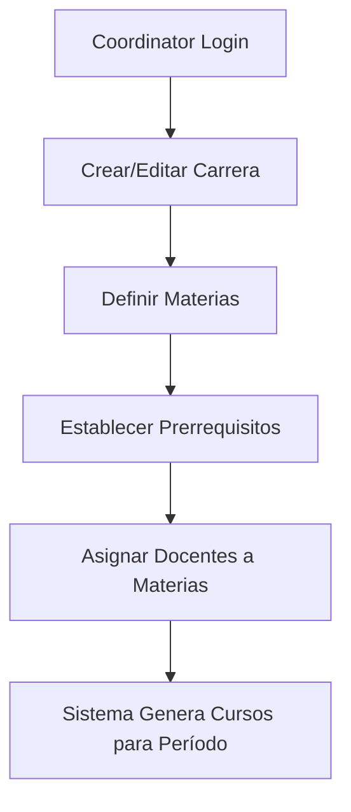
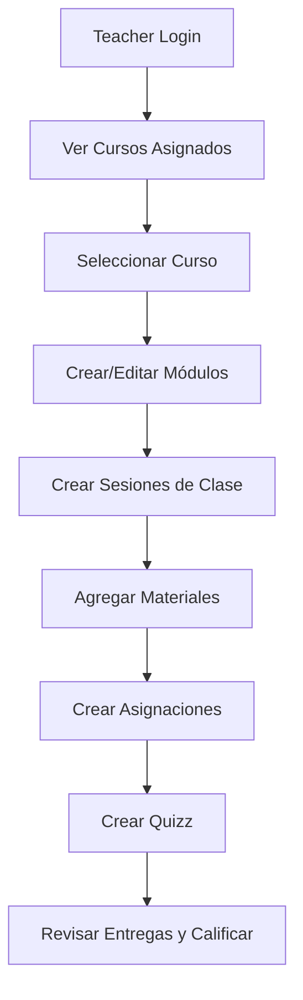
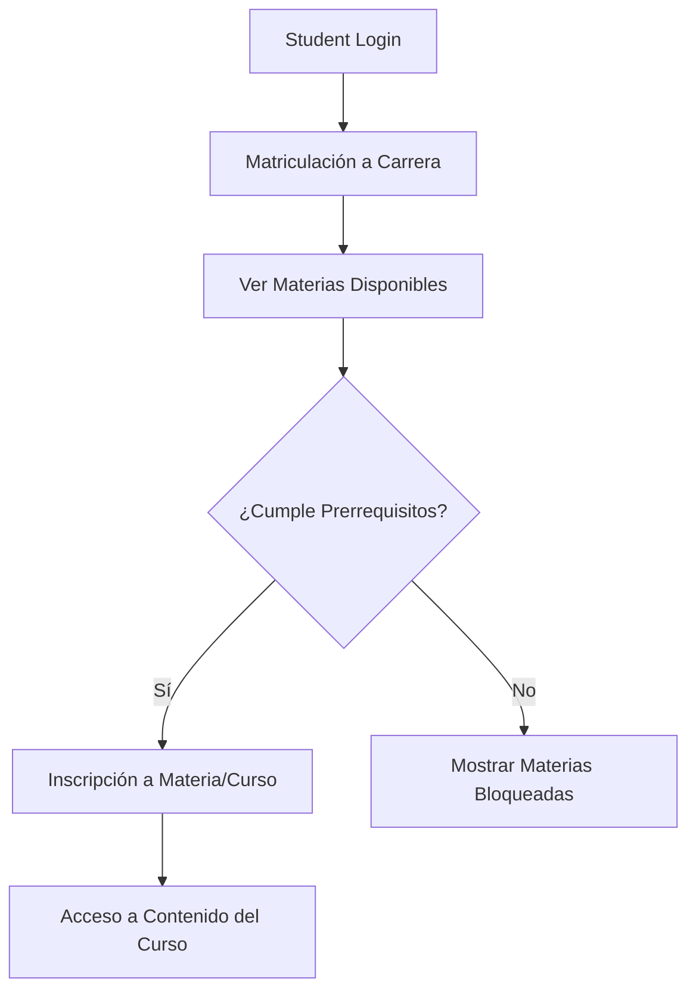
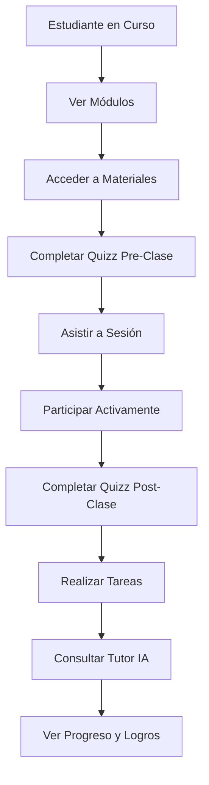
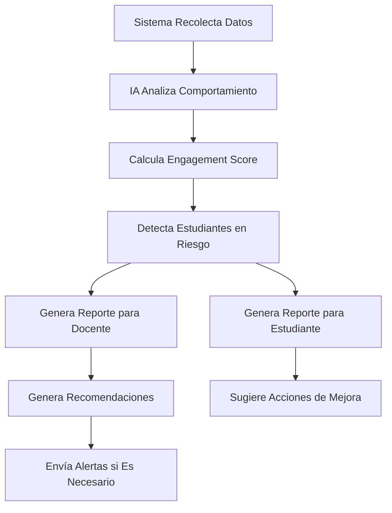

# Arquitectura Educativa Completa - EduSpark
## Análisis Profesional y Hoja de Ruta

**Fecha:** Octubre 2025  
**Estado:** Documento de Arquitectura y Planificación

---

## 📋 Tabla de Contenidos

1. [Situación Actual](#situación-actual)
2. [Análisis de Gaps](#análisis-de-gaps)
3. [Arquitectura Propuesta](#arquitectura-propuesta)
4. [Modelo de Datos Completo](#modelo-de-datos-completo)
5. [Flujos Críticos](#flujos-críticos)
6. [Integración con IA](#integración-con-ia)
7. [Gamificación](#gamificación)
8. [Hoja de Ruta de Desarrollo](#hoja-de-ruta-de-desarrollo)

---

## 🎯 Situación Actual

### Estructura Actual de Relaciones

```
users (estudiantes, docentes, admin)
  ↓
courses (cursos creados por docente)
  ↓
course_modules (módulos dentro de cursos)
  ↓
course_materials (materiales asociados a módulos)
```

### Problemas Identificados

1. **❌ Falta de Matriculación/Inscripción**
   - No existe tabla `enrollments` funcional
   - No hay vínculo formal estudiante-curso
   - Imposible hacer seguimiento individual

2. **❌ Sin Seguimiento de Progreso**
   - No se registra avance del estudiante
   - No hay métricas de compromiso
   - No existe tracking de tiempo de estudio

3. **❌ Ausencia de Sistema de Asistencia**
   - No hay registro de presencia en clases
   - No se trackea participación activa

4. **❌ Falta de Sistema de Tareas/Entregas**
   - Existe tabla `assignments` pero no está integrada
   - No hay workflow de evaluación
   - No hay sistema de calificaciones completo

5. **❌ Sin Coordinador Académico**
   - No existe rol de coordinador
   - No hay estructura de malla curricular
   - No hay asignación docente-materia formal

6. **❌ Gamificación Inexistente**
   - No hay quizz ni trivias
   - No hay sistema de puntos/logros
   - No hay motivación por logros

---

## 🔍 Análisis de Gaps

### Gap 1: Gestión Académica Estructural

**Problema:** Falta jerarquía académica real:
- Carrera → Materia → Curso → Módulo → Clase → Material

**Solución:** Crear estructura jerárquica completa con:
- `careers` (carreras/mallas curriculares)
- `subjects` (materias/disciplinas)
- `courses` (instancias de materia por semestre)
- `course_modules` (ya existe)
- `class_sessions` (sesiones/clases presenciales o virtuales)
- `course_materials` (ya existe)

### Gap 2: Matriculación y Seguimiento

**Problema:** No hay forma de vincular estudiante con su trayectoria académica.

**Solución:** Sistema completo de:
- Matriculación por carrera
- Inscripción a materias/cursos
- Seguimiento de progreso por módulo/clase
- Métricas de compromiso y participación

### Gap 3: Coordinador Académico

**Problema:** No existe figura que gestione malla curricular.

**Solución:** Rol `coordinator` con capacidades de:
- Crear y gestionar carreras
- Definir materias y prerrequisitos
- Asignar docentes a materias
- Configurar planes de estudio

### Gap 4: Evaluación y Tareas

**Problema:** Sistema de tareas no integrado ni completo.

**Solución:** Sistema robusto de:
- Asignaciones con fechas límite
- Entregas con tracking de tiempo
- Calificaciones con rubricas
- Feedback automatizado por IA

### Gap 5: Gamificación y Engagement

**Problema:** No hay elementos motivacionales ni interactivos.

**Solución:** Sistema completo de:
- Quizz interactivos (pre/post clase)
- Trivias temáticas
- Sistema de puntos y logros
- Leaderboards y rankings
- Badges y certificaciones

### Gap 6: IA Analítica y Predictiva

**Problema:** IA solo para respuestas, no para análisis.

**Solución:** IA analítica que:
- Analiza compromiso y participación
- Detecta riesgo de deserción
- Genera reportes automáticos para docentes
- Sugiere intervenciones pedagógicas
- Predice rendimiento

---

## 🏗️ Arquitectura Propuesta

### Jerarquía Académica Completa

```
Institution
  └─ Careers (Carreras/Mallas)
      └─ Subjects (Materias)
          └─ Courses (Instancias de Materia)
              ├─ Coordinador asigna → Teacher
              └─ Modules (Módulos del Curso)
                  └─ Class Sessions (Clases)
                      ├─ Materials
                      ├─ Assignments
                      └─ Quizzes
                          └─ Student Submissions
```

### Roles del Sistema

1. **Admin**: Gestión completa del sistema
2. **Coordinator**: Gestión académica (carreras, materias, asignaciones)
3. **Teacher**: Gestión de cursos asignados (módulos, clases, contenido, evaluación)
4. **Student**: Acceso a cursos inscritos, materiales, tareas, evaluación

---

## 📊 Modelo de Datos Completo

### Nuevas Tablas Principales

#### 1. Carreras y Mallas Curriculares

```sql
-- Tabla de carreras/programas académicos
CREATE TABLE careers (
  id SERIAL PRIMARY KEY,
  name VARCHAR(255) NOT NULL,
  code VARCHAR(50) UNIQUE NOT NULL,
  description TEXT,
  coordinator_id UUID REFERENCES users(id), -- Coordinador responsable
  duration_months INTEGER, -- Duración en meses
  total_credits INTEGER,
  is_active BOOLEAN DEFAULT true,
  created_at TIMESTAMPTZ DEFAULT NOW(),
  updated_at TIMESTAMPTZ DEFAULT NOW()
);

-- Tabla de materias/disciplinas
CREATE TABLE subjects (
  id SERIAL PRIMARY KEY,
  career_id INTEGER REFERENCES careers(id) ON DELETE CASCADE,
  name VARCHAR(255) NOT NULL,
  code VARCHAR(50) NOT NULL,
  description TEXT,
  credits INTEGER DEFAULT 0,
  hours_per_week INTEGER,
  semester INTEGER, -- Semestre en el que se dicta
  prerequisite_subject_id INTEGER REFERENCES subjects(id), -- Materia prerrequisito
  is_core BOOLEAN DEFAULT true, -- Materia obligatoria vs electiva
  created_at TIMESTAMPTZ DEFAULT NOW(),
  UNIQUE(career_id, code)
);
```

#### 2. Matriculación e Inscripciones

```sql
-- Matriculación: Estudiante se inscribe a una carrera
CREATE TABLE career_enrollments (
  id UUID PRIMARY KEY DEFAULT gen_random_uuid(),
  student_id UUID REFERENCES users(id) ON DELETE CASCADE,
  career_id INTEGER REFERENCES careers(id) ON DELETE CASCADE,
  enrollment_date DATE DEFAULT CURRENT_DATE,
  status VARCHAR(20) DEFAULT 'active', -- active, completed, suspended, dropped
  graduation_date DATE,
  current_semester INTEGER DEFAULT 1,
  total_credits_earned INTEGER DEFAULT 0,
  gpa DECIMAL(4,2), -- Grade Point Average
  created_at TIMESTAMPTZ DEFAULT NOW(),
  updated_at TIMESTAMPTZ DEFAULT NOW(),
  UNIQUE(student_id, career_id)
);

-- Inscripción: Estudiante se inscribe a una materia (curso)
CREATE TABLE course_enrollments (
  id UUID PRIMARY KEY DEFAULT gen_random_uuid(),
  student_id UUID REFERENCES users(id) ON DELETE CASCADE,
  course_id INTEGER REFERENCES courses(id) ON DELETE CASCADE,
  enrollment_date DATE DEFAULT CURRENT_DATE,
  status VARCHAR(20) DEFAULT 'active', -- active, completed, failed, dropped
  final_grade DECIMAL(5,2),
  attendance_percentage DECIMAL(5,2) DEFAULT 0,
  participation_score DECIMAL(5,2) DEFAULT 0,
  completion_percentage DECIMAL(5,2) DEFAULT 0,
  last_access_at TIMESTAMPTZ,
  completed_at TIMESTAMPTZ,
  created_at TIMESTAMPTZ DEFAULT NOW(),
  updated_at TIMESTAMPTZ DEFAULT NOW(),
  UNIQUE(student_id, course_id)
);
```

#### 3. Coordinador y Asignaciones

```sql
-- Asignación de docente a materia
CREATE TABLE subject_assignments (
  id SERIAL PRIMARY KEY,
  subject_id INTEGER REFERENCES subjects(id) ON DELETE CASCADE,
  teacher_id UUID REFERENCES users(id) ON DELETE CASCADE,
  academic_period VARCHAR(50), -- "2025-1", "2025-2", etc.
  start_date DATE,
  end_date DATE,
  status VARCHAR(20) DEFAULT 'active', -- active, completed, cancelled
  assigned_by UUID REFERENCES users(id), -- Coordinador que asigna
  created_at TIMESTAMPTZ DEFAULT NOW(),
  UNIQUE(subject_id, teacher_id, academic_period)
);

-- Cursos (instancias de materia por período)
ALTER TABLE courses ADD COLUMN IF NOT EXISTS subject_id INTEGER REFERENCES subjects(id);
ALTER TABLE courses ADD COLUMN IF NOT EXISTS academic_period VARCHAR(50);
ALTER TABLE courses ADD COLUMN IF NOT EXISTS start_date DATE;
ALTER TABLE courses ADD COLUMN IF NOT EXISTS end_date DATE;
ALTER TABLE courses ADD COLUMN IF NOT EXISTS schedule JSONB; -- Horarios de clases
```

#### 4. Sesiones de Clase y Asistencia

```sql
-- Sesiones/clases del curso
CREATE TABLE class_sessions (
  id UUID PRIMARY KEY DEFAULT gen_random_uuid(),
  course_id INTEGER REFERENCES courses(id) ON DELETE CASCADE,
  module_id INTEGER REFERENCES course_modules(id) ON DELETE SET NULL,
  session_number INTEGER NOT NULL,
  title VARCHAR(255) NOT NULL,
  scheduled_date TIMESTAMPTZ NOT NULL,
  duration_minutes INTEGER DEFAULT 60,
  session_type VARCHAR(20) DEFAULT 'regular', -- regular, exam, workshop, lab
  location VARCHAR(255), -- Aula física o URL virtual
  description TEXT,
  is_mandatory BOOLEAN DEFAULT true,
  materials_summary TEXT, -- Resumen de materiales a cubrir
  created_at TIMESTAMPTZ DEFAULT NOW(),
  updated_at TIMESTAMPTZ DEFAULT NOW(),
  UNIQUE(course_id, session_number)
);

-- Asistencia a clases
CREATE TABLE attendance (
  id UUID PRIMARY KEY DEFAULT gen_random_uuid(),
  session_id UUID REFERENCES class_sessions(id) ON DELETE CASCADE,
  student_id UUID REFERENCES users(id) ON DELETE CASCADE,
  status VARCHAR(20) DEFAULT 'present', -- present, absent, late, excused
  checked_in_at TIMESTAMPTZ,
  checked_out_at TIMESTAMPTZ,
  notes TEXT,
  recorded_by UUID REFERENCES users(id), -- Docente que registra
  created_at TIMESTAMPTZ DEFAULT NOW(),
  UNIQUE(session_id, student_id)
);

-- Participación en clases (tracking automático)
CREATE TABLE class_participation (
  id UUID PRIMARY KEY DEFAULT gen_random_uuid(),
  session_id UUID REFERENCES class_sessions(id) ON DELETE CASCADE,
  student_id UUID REFERENCES users(id) ON DELETE CASCADE,
  participation_type VARCHAR(50), -- question, answer, discussion, activity
  participation_score DECIMAL(3,1) DEFAULT 0, -- 0-10
  details JSONB, -- Detalles de la participación
  recorded_at TIMESTAMPTZ DEFAULT NOW(),
  created_at TIMESTAMPTZ DEFAULT NOW()
);
```

#### 5. Tareas y Entregas Mejoradas

```sql
-- Mejorar tabla assignments existente
ALTER TABLE assignments ADD COLUMN IF NOT EXISTS module_id INTEGER REFERENCES course_modules(id);
ALTER TABLE assignments ADD COLUMN IF NOT EXISTS session_id UUID REFERENCES class_sessions(id);
ALTER TABLE assignments ADD COLUMN IF NOT EXISTS assignment_type VARCHAR(50) DEFAULT 'homework'; -- homework, project, exam, quiz
ALTER TABLE assignments ADD COLUMN IF NOT EXISTS instructions TEXT;
ALTER TABLE assignments ADD COLUMN IF NOT EXISTS rubric JSONB; -- Criterios de evaluación
ALTER TABLE assignments ADD COLUMN IF NOT EXISTS allow_late_submission BOOLEAN DEFAULT false;
ALTER TABLE assignments ADD COLUMN IF NOT EXISTS max_attempts INTEGER DEFAULT 1;

-- Mejorar tabla assignment_submissions
ALTER TABLE assignment_submissions ADD COLUMN IF NOT EXISTS attempt_number INTEGER DEFAULT 1;
ALTER TABLE assignment_submissions ADD COLUMN IF NOT EXISTS submission_status VARCHAR(20) DEFAULT 'submitted'; -- submitted, graded, returned
ALTER TABLE assignment_submissions ADD COLUMN IF NOT EXISTS auto_feedback TEXT; -- Feedback generado por IA
ALTER TABLE assignment_submissions ADD COLUMN IF NOT EXISTS rubric_scores JSONB; -- Puntajes por criterio
ALTER TABLE assignment_submissions ADD COLUMN IF NOT EXISTS time_spent_minutes INTEGER;
```

#### 6. Gamificación

```sql
-- Quizz y evaluaciones rápidas
CREATE TABLE quizzes (
  id UUID PRIMARY KEY DEFAULT gen_random_uuid(),
  course_id INTEGER REFERENCES courses(id) ON DELETE CASCADE,
  module_id INTEGER REFERENCES course_modules(id) ON DELETE SET NULL,
  session_id UUID REFERENCES class_sessions(id) ON DELETE SET NULL,
  title VARCHAR(255) NOT NULL,
  description TEXT,
  quiz_type VARCHAR(50) DEFAULT 'formative', -- formative (antes clase), summative (después clase), practice
  max_points DECIMAL(5,2) DEFAULT 100,
  time_limit_minutes INTEGER,
  randomize_questions BOOLEAN DEFAULT false,
  show_results_immediately BOOLEAN DEFAULT true,
  created_at TIMESTAMPTZ DEFAULT NOW(),
  updated_at TIMESTAMPTZ DEFAULT NOW()
);

-- Preguntas de quizz
CREATE TABLE quiz_questions (
  id UUID PRIMARY KEY DEFAULT gen_random_uuid(),
  quiz_id UUID REFERENCES quizzes(id) ON DELETE CASCADE,
  question_type VARCHAR(50) DEFAULT 'multiple_choice', -- multiple_choice, true_false, short_answer, essay
  question_text TEXT NOT NULL,
  options JSONB, -- Para multiple choice: ["opción 1", "opción 2", ...]
  correct_answer TEXT,
  points DECIMAL(5,2) DEFAULT 1,
  explanation TEXT, -- Explicación de la respuesta correcta
  difficulty VARCHAR(20) DEFAULT 'medium', -- easy, medium, hard
  order_index INTEGER DEFAULT 0,
  created_at TIMESTAMPTZ DEFAULT NOW()
);

-- Respuestas de estudiantes
CREATE TABLE quiz_attempts (
  id UUID PRIMARY KEY DEFAULT gen_random_uuid(),
  quiz_id UUID REFERENCES quizzes(id) ON DELETE CASCADE,
  student_id UUID REFERENCES users(id) ON DELETE CASCADE,
  started_at TIMESTAMPTZ DEFAULT NOW(),
  completed_at TIMESTAMPTZ,
  score DECIMAL(5,2),
  percentage DECIMAL(5,2),
  answers JSONB, -- {"question_id": "answer", ...}
  time_spent_seconds INTEGER,
  is_passed BOOLEAN,
  attempt_number INTEGER DEFAULT 1,
  created_at TIMESTAMPTZ DEFAULT NOW()
);

-- Sistema de puntos y logros
CREATE TABLE student_points (
  id UUID PRIMARY KEY DEFAULT gen_random_uuid(),
  student_id UUID REFERENCES users(id) ON DELETE CASCADE,
  course_id INTEGER REFERENCES courses(id) ON DELETE CASCADE,
  points INTEGER DEFAULT 0,
  source VARCHAR(50), -- quiz, assignment, attendance, participation, bonus
  source_id UUID, -- ID del quiz, assignment, etc.
  reason TEXT, -- Motivo de los puntos
  earned_at TIMESTAMPTZ DEFAULT NOW(),
  created_at TIMESTAMPTZ DEFAULT NOW()
);

-- Logros y badges
CREATE TABLE achievements (
  id UUID PRIMARY KEY DEFAULT gen_random_uuid(),
  title VARCHAR(255) NOT NULL,
  description TEXT,
  icon VARCHAR(50), -- Nombre del icono
  points_required INTEGER DEFAULT 0,
  achievement_type VARCHAR(50), -- perfect_score, attendance_streak, early_bird, etc.
  course_id INTEGER REFERENCES courses(id) ON DELETE SET NULL, -- NULL = logro global
  created_at TIMESTAMPTZ DEFAULT NOW()
);

-- Logros obtenidos por estudiantes
CREATE TABLE student_achievements (
  id UUID PRIMARY KEY DEFAULT gen_random_uuid(),
  student_id UUID REFERENCES users(id) ON DELETE CASCADE,
  achievement_id UUID REFERENCES achievements(id) ON DELETE CASCADE,
  earned_at TIMESTAMPTZ DEFAULT NOW(),
  UNIQUE(student_id, achievement_id)
);
```

#### 7. Seguimiento y Progreso

```sql
-- Progreso por módulo
CREATE TABLE module_progress (
  id UUID PRIMARY KEY DEFAULT gen_random_uuid(),
  enrollment_id UUID REFERENCES course_enrollments(id) ON DELETE CASCADE,
  module_id INTEGER REFERENCES course_modules(id) ON DELETE CASCADE,
  completion_percentage DECIMAL(5,2) DEFAULT 0,
  materials_viewed INTEGER DEFAULT 0,
  materials_total INTEGER DEFAULT 0,
  time_spent_minutes INTEGER DEFAULT 0,
  last_accessed_at TIMESTAMPTZ,
  completed_at TIMESTAMPTZ,
  created_at TIMESTAMPTZ DEFAULT NOW(),
  updated_at TIMESTAMPTZ DEFAULT NOW(),
  UNIQUE(enrollment_id, module_id)
);

-- Seguimiento de compromiso (para IA analítica)
CREATE TABLE student_engagement (
  id UUID PRIMARY KEY DEFAULT gen_random_uuid(),
  student_id UUID REFERENCES users(id) ON DELETE CASCADE,
  course_id INTEGER REFERENCES courses(id) ON DELETE CASCADE,
  date DATE DEFAULT CURRENT_DATE,
  engagement_score DECIMAL(5,2) DEFAULT 0, -- 0-100
  metrics JSONB DEFAULT '{}'::jsonb, -- {
    --   "time_spent_minutes": 120,
    --   "materials_viewed": 5,
    --   "assignments_submitted": 2,
    --   "quizzes_completed": 3,
    --   "participation_count": 5,
    --   "tutor_interactions": 10
    -- }
  risk_level VARCHAR(20), -- low, medium, high (riesgo de deserción)
  created_at TIMESTAMPTZ DEFAULT NOW(),
  UNIQUE(student_id, course_id, date)
);
```

#### 8. Análisis y Reportes por IA

```sql
-- Reportes generados por IA para docentes
CREATE TABLE ai_teacher_reports (
  id UUID PRIMARY KEY DEFAULT gen_random_uuid(),
  course_id INTEGER REFERENCES courses(id) ON DELETE CASCADE,
  report_type VARCHAR(50), -- engagement_summary, risk_analysis, performance_prediction, intervention_suggestions
  report_date DATE DEFAULT CURRENT_DATE,
  period_start DATE,
  period_end DATE,
  insights JSONB DEFAULT '{}'::jsonb, -- Análisis de IA
  recommendations JSONB DEFAULT '[]'::jsonb, -- Recomendaciones generadas
  students_at_risk JSONB DEFAULT '[]'::jsonb, -- Lista de estudiantes en riesgo
  generated_at TIMESTAMPTZ DEFAULT NOW(),
  created_at TIMESTAMPTZ DEFAULT NOW()
);

-- Reportes para estudiantes
CREATE TABLE ai_student_reports (
  id UUID PRIMARY KEY DEFAULT gen_random_uuid(),
  student_id UUID REFERENCES users(id) ON DELETE CASCADE,
  course_id INTEGER REFERENCES courses(id) ON DELETE CASCADE,
  report_type VARCHAR(50), -- progress_summary, study_recommendations, performance_analysis
  insights JSONB DEFAULT '{}'::jsonb,
  recommendations JSONB DEFAULT '[]'::jsonb,
  generated_at TIMESTAMPTZ DEFAULT NOW(),
  created_at TIMESTAMPTZ DEFAULT NOW()
);
```

---

## 🔄 Flujos Críticos

### Flujo 1: Coordinador Crea Malla Curricular



**Implementación:**
1. Coordinador accede a panel de gestión académica
2. Crea carrera con código, duración, créditos
3. Agrega materias con código, créditos, semestre
4. Define prerrequisitos entre materias
5. Asigna docentes a cada materia por período académico
6. Sistema crea automáticamente cursos (instancias) para el período

### Flujo 2: Docente Gestiona Curso



**Implementación:**
1. Docente ve sus cursos asignados por coordinador
2. Crea estructura de módulos del curso
3. Programa sesiones de clase con fechas/horarios
4. Sube materiales (documentos, videos, links)
5. Crea tareas con fechas límite
6. Genera quizz (antes/durante/después de clase)
7. Revisa entregas, califica con rubricas
8. Recibe reportes de IA sobre progreso de estudiantes

### Flujo 3: Estudiante se Matricula e Inscribe



**Implementación:**
1. Estudiante se matricula a una carrera
2. Ve materias disponibles por semestre
3. Sistema valida prerrequisitos
4. Estudiante se inscribe a materias disponibles
5. Accede automáticamente a cursos asociados

### Flujo 4: Estudiante Interactúa con Curso



**Implementación:**
1. Estudiante navega por módulos del curso
2. Accede a materiales (documentos, videos)
3. Sistema sugiere quizz pre-clase (opcional pero recomendado)
4. Marca asistencia a sesión (o sistema lo hace automáticamente)
5. Docente registra participación
6. Completa quizz post-clase (obligatorio)
7. Entrega tareas antes de fecha límite
8. Consulta tutor IA cuando tiene dudas
9. Ve su progreso, puntos, logros obtenidos

### Flujo 5: IA Analiza y Reporta



**Implementación:**
1. Sistema recolecta datos continuamente:
   - Tiempo en plataforma
   - Materiales vistos
   - Tareas completadas
   - Quizz realizados
   - Participación en clases
   - Interacciones con tutor IA
2. IA procesa datos diariamente
3. Calcula engagement score (0-100)
4. Identifica patrones de riesgo
5. Genera reportes automáticos:
   - Para docentes: resumen de clase, estudiantes en riesgo, sugerencias
   - Para estudiantes: progreso personal, áreas de mejora, recomendaciones

---

## 🤖 Integración con IA

### Servicios de IA Propuestos

#### 1. Servicio de Análisis de Engagement

```typescript
// services/ai/engagementAnalysisService.ts

interface EngagementMetrics {
  timeSpent: number;
  materialsViewed: number;
  assignmentsCompleted: number;
  quizzesCompleted: number;
  participationCount: number;
  tutorInteractions: number;
  attendanceRate: number;
}

interface EngagementAnalysis {
  engagementScore: number; // 0-100
  riskLevel: 'low' | 'medium' | 'high';
  trends: {
    improving: boolean;
    declining: boolean;
    stable: boolean;
  };
  predictions: {
    likelyCompletion: number; // 0-100
    recommendedInterventions: string[];
  };
}

export class EngagementAnalysisService {
  async analyzeStudentEngagement(
    studentId: string,
    courseId: string,
    periodDays: number = 7
  ): Promise<EngagementAnalysis> {
    // Recolectar métricas
    const metrics = await this.collectMetrics(studentId, courseId, periodDays);
    
    // Calcular score base
    const baseScore = this.calculateBaseScore(metrics);
    
    // Usar IA (Gemini) para análisis contextual
    const aiAnalysis = await this.getAIAnalysis(metrics, baseScore);
    
    // Combinar análisis automático + IA
    return {
      engagementScore: aiAnalysis.refinedScore,
      riskLevel: aiAnalysis.riskLevel,
      trends: aiAnalysis.trends,
      predictions: aiAnalysis.predictions
    };
  }
  
  private async getAIAnalysis(
    metrics: EngagementMetrics,
    baseScore: number
  ): Promise<any> {
    const prompt = `
Analiza el compromiso académico de un estudiante con las siguientes métricas:
- Tiempo de estudio: ${metrics.timeSpent} minutos
- Materiales vistos: ${metrics.materialsViewed}
- Tareas completadas: ${metrics.assignmentsCompleted}
- Quizz completados: ${metrics.quizzesCompleted}
- Participación: ${metrics.participationCount} veces
- Interacciones con tutor: ${metrics.tutorInteractions}
- Asistencia: ${metrics.attendanceRate}%

Score calculado automáticamente: ${baseScore}/100

Proporciona:
1. Score refinado (0-100) considerando contexto
2. Nivel de riesgo (low/medium/high)
3. Tendencias (mejora, declive, estable)
4. Predicción de probabilidad de completar curso (0-100%)
5. Recomendaciones específicas de intervención
    `;
    
    // Llamar a Gemini para análisis
    const response = await geminiService.generateContent(prompt);
    return JSON.parse(response);
  }
}
```

#### 2. Servicio de Generación de Reportes

```typescript
// services/ai/reportGenerationService.ts

export class ReportGenerationService {
  // Generar reporte para docente
  async generateTeacherReport(
    courseId: string,
    periodStart: Date,
    periodEnd: Date
  ): Promise<TeacherReport> {
    // Recolectar datos del período
    const courseData = await this.getCourseData(courseId);
    const enrollments = await this.getEnrollments(courseId);
    const engagementData = await this.getEngagementData(courseId, periodStart, periodEnd);
    
    // Analizar con IA
    const analysis = await this.analyzeWithAI(courseData, enrollments, engagementData);
    
    return {
      course: courseData,
      period: { start: periodStart, end: periodEnd },
      summary: {
        totalStudents: enrollments.length,
        averageEngagement: analysis.avgEngagement,
        studentsAtRisk: analysis.atRisk,
        topPerformers: analysis.topPerformers
      },
      insights: analysis.insights,
      recommendations: analysis.recommendations,
      studentsAtRisk: analysis.riskStudents
    };
  }
  
  // Generar reporte para estudiante
  async generateStudentReport(
    studentId: string,
    courseId: string
  ): Promise<StudentReport> {
    // Datos del estudiante
    const progress = await this.getStudentProgress(studentId, courseId);
    const engagement = await this.getStudentEngagement(studentId, courseId);
    
    // Análisis personalizado con IA
    const personalizedAnalysis = await this.getPersonalizedAnalysis(progress, engagement);
    
    return {
      progress: progress,
      engagement: engagement,
      strengths: personalizedAnalysis.strengths,
      areasForImprovement: personalizedAnalysis.areasForImprovement,
      recommendations: personalizedAnalysis.recommendations,
      predictedGrade: personalizedAnalysis.predictedGrade
    };
  }
}
```

#### 3. Servicio de Generación de Quizz Inteligentes

```typescript
// services/ai/quizGenerationService.ts

export class QuizGenerationService {
  // Generar quizz pre-clase basado en materiales
  async generatePreClassQuiz(
    courseId: string,
    moduleId: number,
    materialIds: string[]
  ): Promise<Quiz> {
    // Obtener materiales
    const materials = await this.getMaterials(materialIds);
    
    // Usar IA para generar preguntas relevantes
    const prompt = `
Basándote en estos materiales del curso:
${materials.map(m => `- ${m.title}: ${m.content.substring(0, 500)}`).join('\n')}

Genera 5 preguntas de opción múltiple que evalúen:
1. Conceptos clave que deben entenderse antes de la clase
2. Términos importantes que aparecerán
3. Contexto necesario para seguir la clase

Formato JSON con: question, options (4 opciones), correct_answer, explanation
    `;
    
    const aiResponse = await geminiService.generateContent(prompt);
    const questions = JSON.parse(aiResponse);
    
    return {
      title: 'Quiz Pre-Clase: Evaluación de Preparación',
      type: 'formative',
      questions: questions
    };
  }
  
  // Generar quizz post-clase para reforzamiento
  async generatePostClassQuiz(
    sessionId: string,
    classNotes: string // Transcripción o notas de la clase
  ): Promise<Quiz> {
    // Similar pero enfocado en reforzar lo visto en clase
  }
}
```

---

## 🎮 Gamificación

### Sistema de Puntos

**Puntos por Actividad:**
- Completar quizz pre-clase: +10 puntos
- Completar quizz post-clase: +15 puntos
- Asistencia perfecta en semana: +20 puntos
- Entregar tarea antes de fecha límite: +25 puntos
- Obtener 100% en quizz: +30 puntos
- Participar activamente en clase: +5 puntos por participación
- Consultar tutor IA: +2 puntos por consulta relevante
- Logro de racha de estudio: +50 puntos

### Sistema de Logros

**Ejemplos de Logros:**
- 🏆 **Estudiante Dedicado**: 7 días consecutivos de acceso
- 🎯 **Perfecto**: 100% en 5 quizz consecutivos
- ⚡ **Temprano**: Entregar 3 tareas antes de fecha límite
- 💬 **Participativo**: 10 participaciones en clases
- 📚 **Voraz**: Ver todos los materiales de un módulo
- 🎓 **Completo**: Completar todos los módulos de un curso
- 🤖 **Curioso**: 20 consultas al tutor IA

### Leaderboards

- Ranking general del curso
- Ranking por módulo
- Ranking de la semana
- Ranking de participación

---

## 📅 Hoja de Ruta de Desarrollo

### Fase 1: Fundamentos (Semanas 1-4)

#### Semana 1-2: Estructura Académica Base
- ✅ Crear tablas: `careers`, `subjects`
- ✅ Crear tablas: `career_enrollments`, `course_enrollments`
- ✅ Agregar columnas necesarias a `courses`
- ✅ Crear tabla `subject_assignments`
- ✅ Implementar RLS para nuevas tablas
- ✅ Crear vistas útiles para consultas

**Entregables:**
- Scripts SQL completos
- Migración de datos existentes
- Pruebas de integridad referencial

#### Semana 3-4: Coordinador Académico
- ✅ Crear rol `coordinator` en sistema
- ✅ Panel de coordinador para:
  - Gestión de carreras
  - Gestión de materias
  - Asignación de docentes
- ✅ Flujo completo de creación de malla curricular
- ✅ Validación de prerrequisitos

**Entregables:**
- UI de coordinador funcional
- Flujo end-to-end de creación de malla

### Fase 2: Docente y Contenido (Semanas 5-8)

#### Semana 5-6: Sesiones de Clase y Asistencia
- ✅ Crear tabla `class_sessions`
- ✅ Crear tabla `attendance`
- ✅ Crear tabla `class_participation`
- ✅ UI para docente: crear sesiones
- ✅ UI para docente: tomar asistencia
- ✅ UI para docente: registrar participación
- ✅ UI para estudiante: ver asistencia propia

**Entregables:**
- Sistema completo de asistencia
- Tracking automático cuando sea posible

#### Semana 7-8: Materiales y Contenido Mejorado
- ✅ Mejorar flujo de carga de materiales
- ✅ Soporte para múltiples tipos de contenido
- ✅ Organización por módulo y sesión
- ✅ Vista previa de materiales

**Entregables:**
- Editor de contenido mejorado
- Sistema de organización robusto

### Fase 3: Evaluación y Tareas (Semanas 9-12)

#### Semana 9-10: Sistema de Tareas Completo
- ✅ Mejorar tabla `assignments`
- ✅ Mejorar tabla `assignment_submissions`
- ✅ UI para docente: crear tareas con rubricas
- ✅ UI para estudiante: entregar tareas
- ✅ Sistema de calificación con feedback
- ✅ Notificaciones de fechas límite

**Entregables:**
- Sistema completo de tareas funcional
- Workflow de evaluación implementado

#### Semana 11-12: Quizz y Evaluaciones
- ✅ Crear tablas: `quizzes`, `quiz_questions`, `quiz_attempts`
- ✅ UI para docente: crear quizz
- ✅ UI para estudiante: tomar quizz
- ✅ Sistema de calificación automática
- ✅ Integración con materiales del curso

**Entregables:**
- Sistema de quizz funcional
- Calificación automática para opción múltiple

### Fase 4: Gamificación (Semanas 13-16)

#### Semana 13-14: Sistema de Puntos y Logros
- ✅ Crear tablas: `student_points`, `achievements`, `student_achievements`
- ✅ Lógica de asignación de puntos
- ✅ Sistema de logros automáticos
- ✅ UI para mostrar puntos y logros
- ✅ Notificaciones de logros obtenidos

**Entregables:**
- Sistema de gamificación funcional
- Dashboard de logros para estudiantes

#### Semana 15-16: Leaderboards y Rankings
- ✅ Crear vistas de rankings
- ✅ UI de leaderboards
- ✅ Filtros por período, módulo, curso
- ✅ Privacidad: opción de ocultar nombre en rankings

**Entregables:**
- Sistema completo de rankings
- Configuración de privacidad

### Fase 5: IA Analítica (Semanas 17-20)

#### Semana 17-18: Recolección de Datos y Métricas
- ✅ Implementar tracking de todas las actividades
- ✅ Crear tabla `student_engagement`
- ✅ Calcular métricas diarias
- ✅ Agregar columnas de tracking a tablas existentes

**Entregables:**
- Sistema de tracking completo
- Base de datos de métricas funcionando

#### Semana 19-20: Servicios de IA Analítica
- ✅ Implementar `EngagementAnalysisService`
- ✅ Implementar `ReportGenerationService`
- ✅ Crear tablas: `ai_teacher_reports`, `ai_student_reports`
- ✅ Generar reportes automáticos diarios/semanales
- ✅ Dashboard de reportes para docentes
- ✅ Dashboard de reportes para estudiantes

**Entregables:**
- IA analítica funcionando
- Reportes automáticos generándose

### Fase 6: Generación Inteligente de Contenido (Semanas 21-24)

#### Semana 21-22: Quizz Generados por IA
- ✅ Implementar `QuizGenerationService`
- ✅ Generar quizz pre-clase desde materiales
- ✅ Generar quizz post-clase desde notas/transcripciones
- ✅ UI para docente: generar quizz automáticamente
- ✅ Opción de editar quizz generados

**Entregables:**
- Generación automática de quizz funcional
- Herramientas de edición para docente

#### Semana 23-24: Feedback y Recomendaciones Personalizadas
- ✅ Feedback automático en tareas por IA
- ✅ Recomendaciones de estudio personalizadas
- ✅ Sugerencias de materiales según progreso
- ✅ Alertas proactivas para estudiantes en riesgo

**Entregables:**
- Sistema de recomendaciones funcionando
- Feedback automatizado implementado

### Fase 7: Optimización y Refinamiento (Semanas 25-28)

#### Semana 25-26: Pruebas y Optimización
- ✅ Pruebas de carga
- ✅ Optimización de consultas
- ✅ Mejora de UX basada en feedback
- ✅ Corrección de bugs

#### Semana 27-28: Documentación y Entrenamiento
- ✅ Documentación completa
- ✅ Guías de usuario
- ✅ Videos tutoriales
- ✅ Entrenamiento para coordinadores y docentes

---

## 🎯 Priorización por Valor

### MVP Mínimo (Primeras 8 semanas)
1. **Matriculación e Inscripciones** (Semana 1-2)
2. **Coordinador y Malla Curricular** (Semana 3-4)
3. **Sesiones y Asistencia** (Semana 5-6)
4. **Materiales Mejorados** (Semana 7-8)

### MVP Extendido (Semanas 9-16)
5. **Sistema de Tareas** (Semana 9-10)
6. **Quizz Básicos** (Semana 11-12)
7. **Gamificación Base** (Semana 13-16)

### Funcionalidades Avanzadas (Semanas 17+)
8. **IA Analítica** (Semana 17-20)
9. **Generación Inteligente** (Semana 21-24)
10. **Optimización** (Semana 25-28)

---

## 💡 Recomendaciones Profesionales

### 1. Arquitectura Modular
- Implementar por fases independientes
- Cada fase debe ser funcional por sí sola
- Permitir rollback si es necesario

### 2. Escalabilidad
- Diseñar para manejar miles de estudiantes
- Optimizar consultas desde el inicio
- Usar índices apropiados
- Considerar cacheo de reportes

### 3. Privacidad y Seguridad
- Todos los datos de estudiantes protegidos con RLS
- Reportes solo visibles para usuarios autorizados
- Cumplimiento con protección de datos (GDPR, etc.)

### 4. Experiencia de Usuario
- Interfaz intuitiva para cada rol
- Feedback inmediato en acciones
- Notificaciones no intrusivas
- Mobile-first para estudiantes

### 5. IA como Asistente, No Reemplazo
- IA sugiere, docentes deciden
- Transparencia en cómo funciona la IA
- Posibilidad de desactivar recomendaciones automáticas

---

## 📊 Métricas de Éxito

### Para Estudiantes
- Tasa de completación de cursos
- Engagement score promedio
- Satisfacción con la plataforma
- Mejora en rendimiento académico

### Para Docentes
- Tiempo ahorrado en gestión
- Calidad de reportes recibidos
- Utilidad de recomendaciones de IA
- Satisfacción con herramientas

### Para la Plataforma
- Reducción de deserción estudiantil
- Aumento en participación
- Uso del tutor IA
- Completación de materiales

---

## 🚀 Conclusión

Esta arquitectura proporciona una base sólida y escalable para un sistema educativo completo con:

✅ **Estructura académica formal**  
✅ **Seguimiento completo de progreso**  
✅ **IA analítica y predictiva**  
✅ **Gamificación motivacional**  
✅ **Flujos claros para cada rol**  
✅ **Hoja de ruta realista y ejecutable**

**Próximo paso:** Revisar y validar esta arquitectura, luego comenzar con Fase 1.

