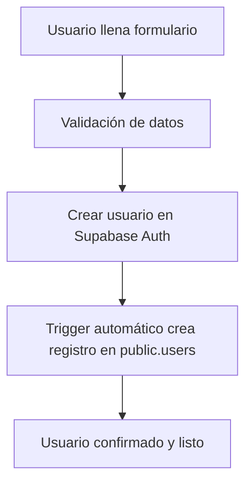
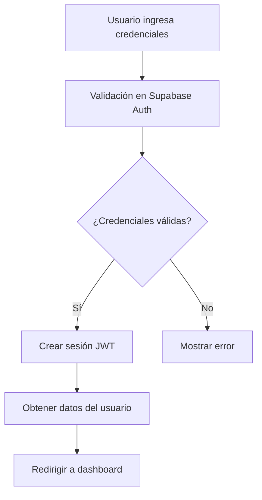
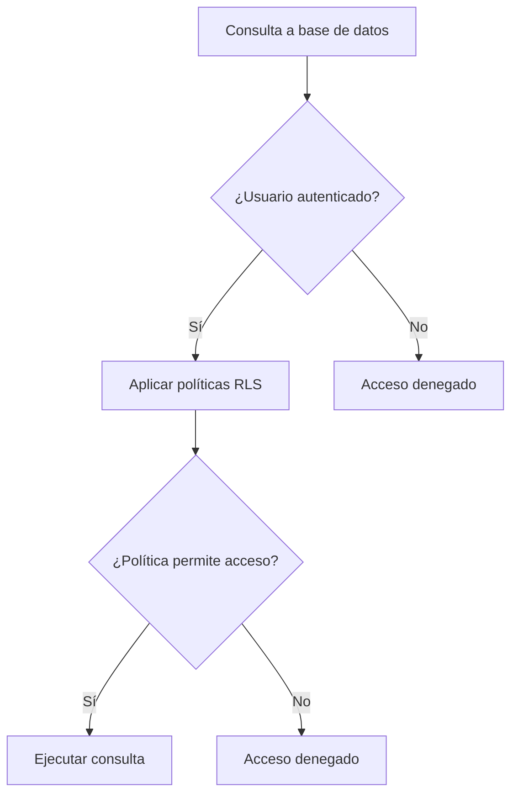
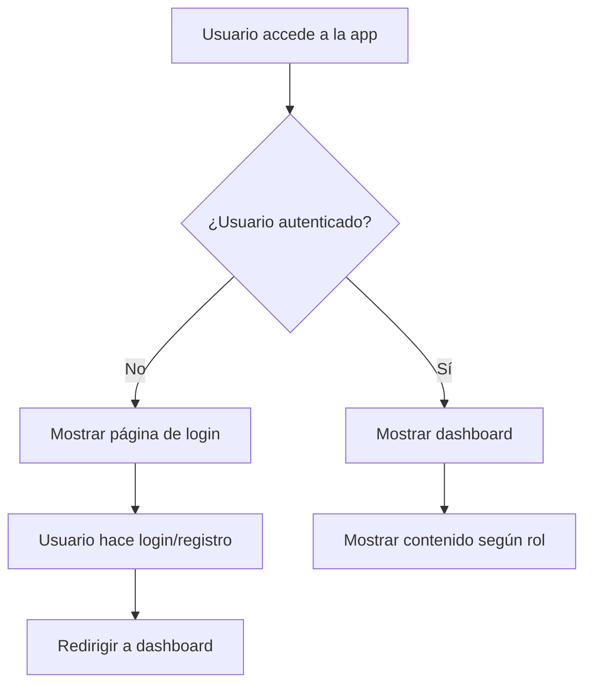
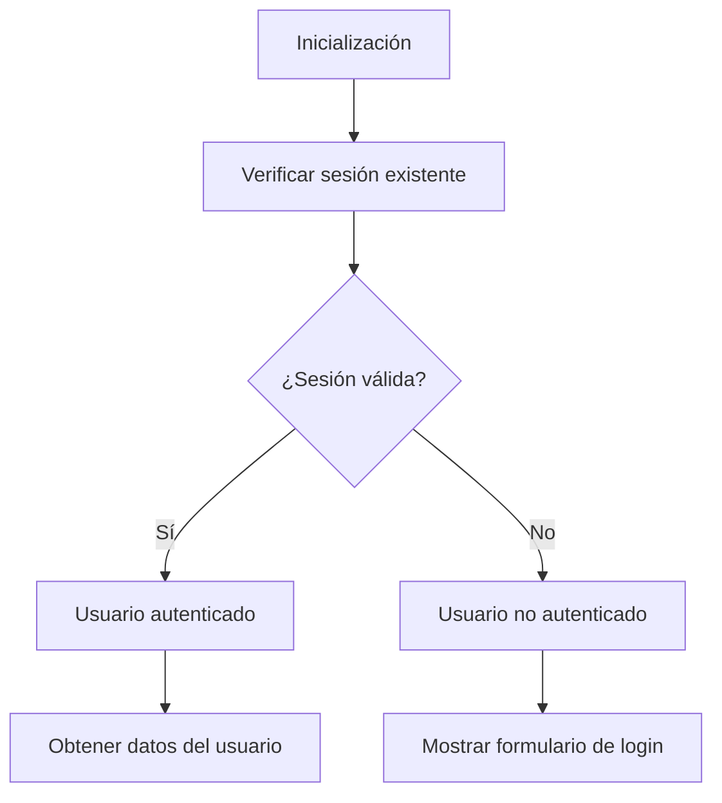
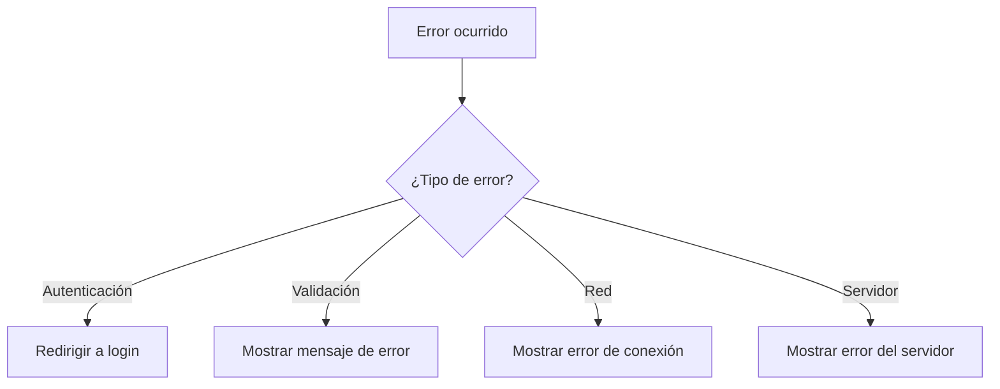
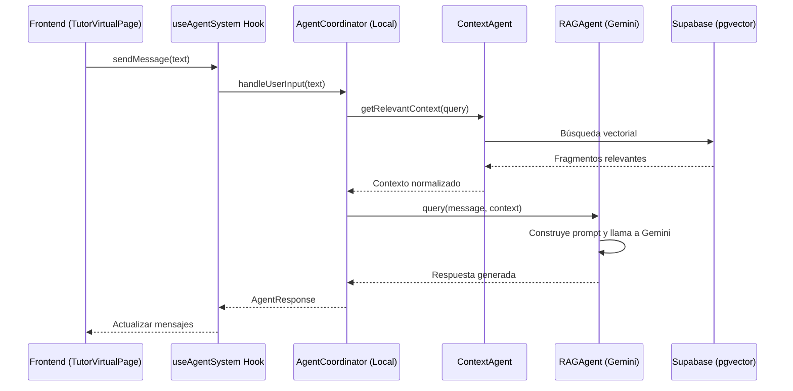

# Flujos Críticos del Sistema EduSpark

## 🔐 Flujo de Autenticación

### **1. Registro de Usuario**


**Pasos detallados:**
1. Usuario completa formulario de registro
2. Validación de datos en frontend
3. Llamada a `supabase.auth.signUp()`
4. Trigger `handle_new_user()` se ejecuta automáticamente
5. Usuario creado en ambas tablas (`auth.users` y `public.users`)

### **2. Login de Usuario**


**Pasos detallados:**
1. Usuario ingresa email y contraseña
2. Llamada a `supabase.auth.signInWithPassword()`
3. Supabase valida credenciales
4. Si es válido, se crea sesión JWT
5. Se obtienen datos del usuario desde `public.users`
6. Usuario es redirigido al dashboard

## 🗄️ Flujo de Sincronización de Datos

### **Sincronización Automática de Usuarios**
```mermaid
graph TD
    A[Nuevo usuario en auth.users] --> B[Trigger on_auth_user_created]
    B --> C[Función handle_new_user()]
    C --> D[Insertar en public.users]
    D --> E[Sincronización completa]
```

**Datos sincronizados:**
- `id` - UUID del usuario
- `email` - Email del usuario
- `first_name` - Nombre del usuario
- `last_name` - Apellido del usuario
- `role_id` - ID del rol asignado

## 🔒 Flujo de Seguridad

### **Row Level Security (RLS)**


**Políticas implementadas:**
- **Roles:** Lectura pública (necesario para registro)
- **Usuarios:** Lectura para autenticados, actualización propia
- **Inserción:** Permitida para registro de nuevos usuarios

## 🎨 Flujo de Interfaz de Usuario

### **Navegación Principal**


### **Estados de la Aplicación**
1. **Loading** - Verificando autenticación
2. **Unauthenticated** - Mostrando login/registro
3. **Authenticated** - Mostrando dashboard
4. **Error** - Mostrando mensaje de error

## 🔄 Flujo de Gestión de Estados

### **Estado de Autenticación**


**Estados del hook useAuth:**
- `user` - Usuario actual o null
- `loading` - Estado de carga
- `isAuthenticated` - Boolean de autenticación
- `login()` - Función de login
- `logout()` - Función de logout
- `register()` - Función de registro

## 🚨 Flujo de Manejo de Errores

### **Errores Comunes y Soluciones**


**Tipos de errores manejados:**
- **401 Unauthorized** - Credenciales inválidas
- **400 Bad Request** - Datos inválidos
- **Network Error** - Problemas de conexión
- **Validation Error** - Errores de validación

## 📊 Flujo de Datos

### **Estructura de Datos del Usuario**
```typescript
interface User {
  id: string;
  email: string;
  first_name: string;
  last_name: string;
  role: {
    id: number;
    name: string;
  };
  created_at: string;
  updated_at: string;
}
```

### **Flujo de Actualización de Datos**
1. Usuario modifica datos
2. Validación en frontend
3. Envío a Supabase
4. Aplicación de políticas RLS
5. Actualización en base de datos
6. Refresco de datos en frontend

## 🤖 Flujo del Tutor Virtual (A2A Local)



**⚠️ NOTA**: Este es un sistema A2A **local** implementado en el frontend, no un coordinador externo distribuido.

**Variables de entorno relevantes (frontend):**
- `VITE_GEMINI_API_KEY` → API Key de Google Gemini
- `VITE_SUPABASE_URL` → URL de Supabase
- `VITE_SUPABASE_ANON_KEY` → Clave anónima de Supabase

## 🔧 Flujo de Configuración

### **Configuración Inicial del Sistema**
1. **Instalación de dependencias**
2. **Configuración de variables de entorno**
3. **Configuración de Supabase**
4. **Creación de tablas y políticas**
5. **Inserción de datos iniciales**
6. **Configuración de triggers**

### **Configuración de Desarrollo**
1. **Clonar repositorio**
2. **Instalar dependencias** (`npm install`)
3. **Configurar variables de entorno**
4. **Ejecutar scripts de base de datos**
5. **Iniciar servidor de desarrollo** (`npm run dev`)

## 📈 Flujo de Monitoreo

### **Métricas Importantes**
- **Tiempo de respuesta** de autenticación
- **Tasa de éxito** de login/registro
- **Errores** de autenticación
- **Uso de recursos** del sistema

### **Logs Importantes**
- **Eventos de autenticación**
- **Errores de base de datos**
- **Errores de red**
- **Cambios de estado** de la aplicación