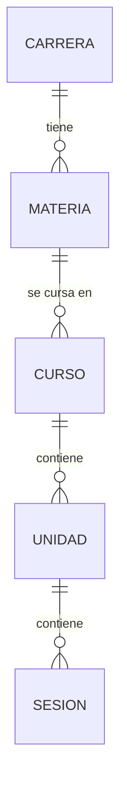

# Diagrama ER de la jerarquía de EduSpark

**Leyenda**
- `||--o{` = relación uno‑a‑muchos (un registro del lado izquierdo puede estar asociado a varios del lado derecho).
- Cada entidad corresponde a una tabla en la base de datos (ver `sql_scripts/add_foreign_keys.sql`).
