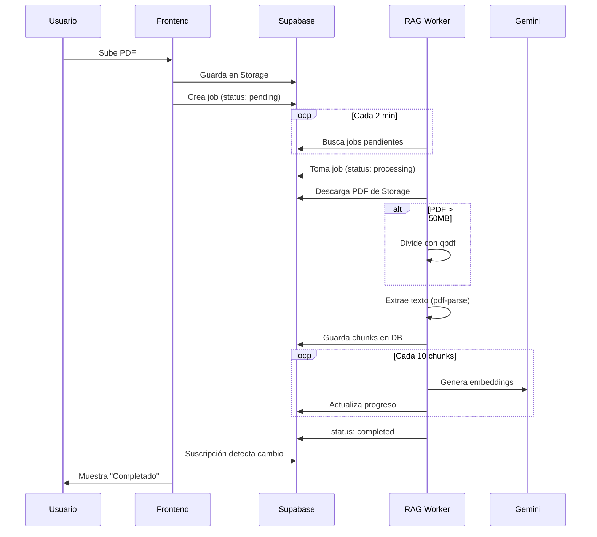

# 🤖 Sistema RAG Core - Guía de Replicación

**Versión:** 2.0  
**Última Actualización:** 10 de Diciembre, 2025  
**Autor:** EduSpark Team

---

## 📋 Índice

1. [Visión General](#1-visión-general)
2. [Arquitectura](#2-arquitectura)
3. [Componentes](#3-componentes)
4. [Base de Datos](#4-base-de-datos)
5. [Despliegue](#5-despliegue)
6. [Configuración](#6-configuración)
7. [Flujo de Procesamiento](#7-flujo-de-procesamiento)
8. [API y Endpoints](#8-api-y-endpoints)
9. [Mantenimiento](#9-mantenimiento)
10. [Troubleshooting](#10-troubleshooting)

---

## 1. Visión General

El Sistema RAG (Retrieval-Augmented Generation) permite indexar documentos PDF para consultas inteligentes con IA. Características principales:

- ✅ Procesamiento de PDFs de cualquier tamaño (probado hasta 137MB)
- ✅ División automática de archivos grandes con `qpdf`
- ✅ Generación de embeddings con Gemini API
- ✅ Recuperación semántica para chat con IA
- ✅ Monitoreo de progreso en tiempo real

---

## 2. Arquitectura

```
┌─────────────────────────────────────────────────────────────────┐
│                         FRONTEND                                │
│  (React + Vite) → Cloud Run                                     │
│  - File Upload UI                                               │
│  - Processing Progress Component                                │
└─────────────────────┬───────────────────────────────────────────┘
                      │
                      ▼
┌─────────────────────────────────────────────────────────────────┐
│                         SUPABASE                                │
│  - Storage: Archivos PDF                                        │
│  - Tables: materials, file_processing_jobs, course_content_chunks│
│  - Auth: JWT tokens                                             │
└─────────────────────┬───────────────────────────────────────────┘
                      │
                      ▼
┌─────────────────────────────────────────────────────────────────┐
│                      RAG WORKER (VM)                            │
│  Google Compute Engine (e2-standard-2)                          │
│  - Node.js + Express                                            │
│  - qpdf para división de PDFs                                   │
│  - pdf-parse para extracción de texto                           │
│  - Gemini API para embeddings                                   │
└─────────────────────────────────────────────────────────────────┘
```

---

## 3. Componentes

### 3.1 RAG Worker (`functions/rag-worker/`)

**Archivo Principal:** `index.js` (en producción debe ser igual a `index.vm.js`)

**Dependencias clave:**
```json
{
  "@supabase/supabase-js": "^2.x",
  "@google/generative-ai": "^0.x",
  "pdf-parse": "^1.x",
  "express": "^4.x",
  "dotenv": "^16.x"
}
```

**Scripts de utilidad:**
| Script | Descripción |
|--------|-------------|
| `check_active_jobs.js` | Lista jobs en `pending` o `processing` |
| `reset_stuck_job.js` | Resetea jobs zombie a `pending` |
| `complete_all_done.js` | Marca jobs 100% procesados como `completed` |
| `monitor_progress.js` | Monitorea progreso de un job específico |

### 3.2 Frontend (`src/components/ProcessingProgress.tsx`)

Componente React que muestra:
- Estado del job (En cola, Procesando, Completado)
- Fase actual (Dividiendo PDF, Extrayendo texto, Generando embeddings)
- Barra de progreso con porcentaje
- Tiempo transcurrido

---

## 4. Base de Datos

### 4.1 Tabla: `file_processing_jobs`

```sql
CREATE TABLE file_processing_jobs (
    id UUID PRIMARY KEY DEFAULT uuid_generate_v4(),
    material_id UUID REFERENCES materials(id),
    file_name TEXT NOT NULL,
    file_size BIGINT,
    status TEXT DEFAULT 'pending', -- pending, processing, completed, failed
    error_message TEXT,
    metadata JSONB DEFAULT '{}',
    created_at TIMESTAMPTZ DEFAULT NOW(),
    updated_at TIMESTAMPTZ DEFAULT NOW()
);
```

**Campos importantes en `metadata`:**
```json
{
  "phase": "embedding",           // split, extracting, embedding, completed
  "chunksTotal": 306,
  "chunksProcessed": 100,
  "totalPages": 1346,
  "ragProcessingType": "full",
  "estimatedCosts": {...}
}
```

### 4.2 Tabla: `course_content_chunks`

```sql
CREATE TABLE course_content_chunks (
    id UUID PRIMARY KEY DEFAULT uuid_generate_v4(),
    material_id UUID REFERENCES materials(id),
    content TEXT NOT NULL,
    chunk_index INTEGER,
    page_start INTEGER,
    page_end INTEGER,
    metadata JSONB DEFAULT '{}',
    embedding VECTOR(768),        -- Embedding de Gemini
    created_at TIMESTAMPTZ DEFAULT NOW()
);
```

### 4.3 Tabla: `materials`

Campo relevante: `rag_status` (pending, processing, completed, failed)

---

## 5. Despliegue

### 5.1 Requisitos de la VM

- **OS:** Ubuntu 22.04 LTS
- **Tipo:** e2-standard-2 (2 vCPU, 8GB RAM)
- **Disco:** 50GB SSD
- **Software:** Node.js 18+, qpdf

### 5.2 Instalación

```bash
# 1. Instalar dependencias del sistema
sudo apt-get update
sudo apt-get install -y qpdf nodejs npm

# 2. Crear directorio
sudo mkdir -p /opt/rag-worker/functions/rag-worker
cd /opt/rag-worker/functions/rag-worker

# 3. Subir archivos (desde máquina local)
gcloud compute scp --recurse functions/rag-worker/* rag-worker-vm:/opt/rag-worker/functions/rag-worker/ --zone=us-central1-a

# 4. Instalar dependencias Node.js
npm install

# 5. Crear archivo .env
cat > .env << EOF
SUPABASE_URL=https://tu-proyecto.supabase.co
SUPABASE_SERVICE_KEY=eyJ...
GEMINI_API_KEY=AIza...
EOF

# 6. Crear servicio systemd
sudo tee /etc/systemd/system/rag-worker.service << EOF
[Unit]
Description=RAG Worker Service
After=network.target

[Service]
Type=simple
User=root
WorkingDirectory=/opt/rag-worker/functions/rag-worker
ExecStart=/usr/bin/node --max-old-space-size=6144 index.js
Restart=always
RestartSec=10
Environment=NODE_ENV=production

[Install]
WantedBy=multi-user.target
EOF

# 7. Iniciar servicio
sudo systemctl daemon-reload
sudo systemctl enable rag-worker
sudo systemctl start rag-worker
```

### 5.3 Actualización del Worker

```bash
# 1. Subir nuevo código
gcloud compute scp functions/rag-worker/index.vm.js rag-worker-vm:/opt/rag-worker/functions/rag-worker/index.vm.js --zone=us-central1-a

# 2. IMPORTANTE: Copiar a index.js (el que ejecuta systemd)
gcloud compute ssh rag-worker-vm --zone=us-central1-a --command="cp /opt/rag-worker/functions/rag-worker/index.vm.js /opt/rag-worker/functions/rag-worker/index.js"

# 3. Reiniciar servicio
gcloud compute ssh rag-worker-vm --zone=us-central1-a --command="sudo systemctl restart rag-worker"
```

---

## 6. Configuración

### 6.1 Variables de Entorno

| Variable | Descripción | Requerida |
|----------|-------------|-----------|
| `SUPABASE_URL` | URL del proyecto Supabase | ✅ |
| `SUPABASE_SERVICE_KEY` | Service role key (bypass RLS) | ✅ |
| `GEMINI_API_KEY` | API key de Google AI Studio | ✅ |

### 6.2 Parámetros del Worker

```javascript
// config.js
const CONFIG = {
    CHUNK_SIZE: 60,              // Páginas por chunk de texto
    PDF_CHUNK_SIZE: 500,         // Páginas por archivo dividido (qpdf)
    BIG_FILE_THRESHOLD: 50 * 1024 * 1024, // 50MB
    PARALLEL_PAGES: 4,           // Páginas a procesar en paralelo
    EMBEDDING_BATCH_SIZE: 10,    // Embeddings por batch
    POLL_INTERVAL: 120000        // Intervalo de polling (2 min)
};
```

---

## 7. Flujo de Procesamiento



---

## 8. API y Endpoints

El worker expone un servidor Express en puerto 8080:

| Endpoint | Método | Descripción |
|----------|--------|-------------|
| `/health` | GET | Health check |
| `/process` | POST | Procesar job manualmente (opcional) |

El procesamiento principal es automático vía polling de la tabla `file_processing_jobs`.

---

## 9. Mantenimiento

### 9.1 Verificar Estado del Worker

```bash
# Ver logs en tiempo real
gcloud compute ssh rag-worker-vm --zone=us-central1-a --command="sudo journalctl -u rag-worker -f"

# Ver últimos 50 logs
gcloud compute ssh rag-worker-vm --zone=us-central1-a --command="sudo journalctl -u rag-worker -n 50 --no-pager"

# Ver estado del servicio
gcloud compute ssh rag-worker-vm --zone=us-central1-a --command="sudo systemctl status rag-worker"
```

### 9.2 Verificar Jobs Activos

```bash
gcloud compute ssh rag-worker-vm --zone=us-central1-a --command="cd /opt/rag-worker/functions/rag-worker && node check_active_jobs.js"
```

### 9.3 Resetear Jobs Zombie

```bash
gcloud compute ssh rag-worker-vm --zone=us-central1-a --command="cd /opt/rag-worker/functions/rag-worker && node reset_stuck_job.js"
```

---

## 10. Troubleshooting

### 10.1 Job queda en "Procesando" al 100%

**Causa:** El worker no actualiza el status a `completed`.

**Solución:**
```bash
# 1. Marcar manualmente
gcloud compute ssh rag-worker-vm --zone=us-central1-a --command="cd /opt/rag-worker/functions/rag-worker && node complete_all_done.js"

# 2. Verificar que index.js = index.vm.js
gcloud compute ssh rag-worker-vm --zone=us-central1-a --command="diff /opt/rag-worker/functions/rag-worker/index.js /opt/rag-worker/functions/rag-worker/index.vm.js"
```

### 10.2 Worker no procesa jobs

**Verificar:**
1. ¿Está corriendo? → `sudo systemctl status rag-worker`
2. ¿Hay jobs pendientes? → `node check_active_jobs.js`
3. ¿Hay errores? → `sudo journalctl -u rag-worker -n 100`

### 10.3 Error "heap out of memory"

**Causa:** PDF muy grande procesado sin qpdf.

**Solución:**
1. Verificar que qpdf está instalado: `which qpdf`
2. Verificar threshold en código: `BIG_FILE_THRESHOLD`
3. Aumentar memoria: `--max-old-space-size=8192`

---

## 📎 Archivos Relacionados

- `AI_CONTEXT/04_FEATURES/SOLUCION_PROCESAMIENTO_PDFS_GRANDES.md` - Detalle de bugs y soluciones
- `functions/rag-worker/index.vm.js` - Código fuente del worker
- `sql_scripts/create_file_processing_jobs_table.sql` - Esquema de la tabla
- `src/components/ProcessingProgress.tsx` - Componente de UI

---

## 🔗 Para Replicar en Otro Sistema

1. **Crear proyecto Supabase** con las tablas descritas
2. **Crear VM en GCP** con los requisitos especificados
3. **Desplegar el worker** siguiendo la sección 5.2
4. **Configurar variables de entorno** con tus credenciales
5. **Integrar frontend** con el componente de progreso
6. **Probar** con un PDF pequeño primero (< 10MB)

---

*Documentación generada para EduSpark - Sistema de Gestión Educativa con IA*
