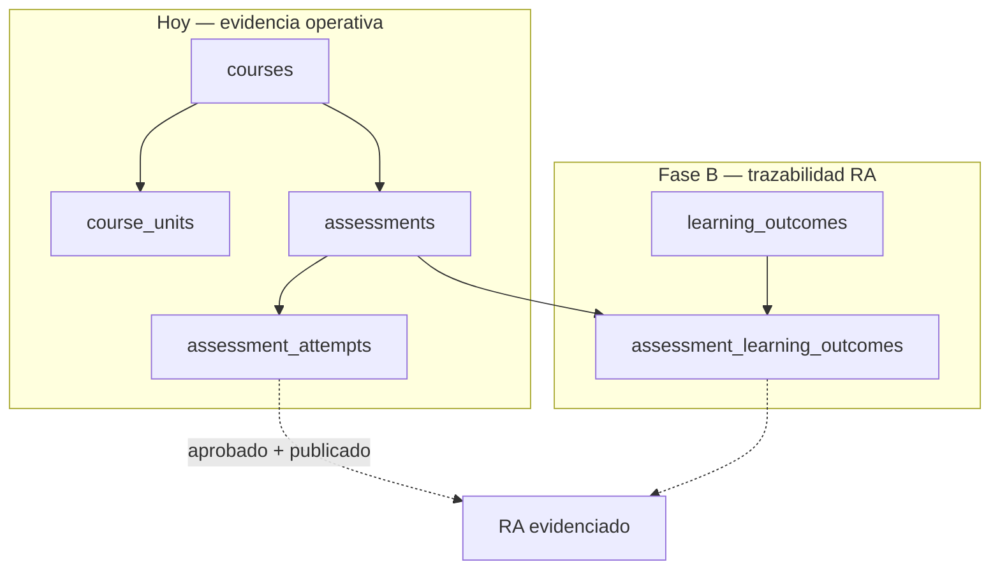

# Sprint 1 semana — Presentación + Fase A (RA / evidencias)

**Contexto:** Presentación en ~7 días. Prioridad: **producto pedagógico-evidencia** alineado a `RESULTADOS_APRENDIZAJE_MARCOS_COMPETENCIAS_EDUSPARK.md`; **mejoras de UI/UX** se posponen salvo ajustes mínimos para la demo.

**Documento maestro:** `AI_CONTEXT/04_FEATURES/RESULTADOS_APRENDIZAJE_MARCOS_COMPETENCIAS_EDUSPARK.md`

### Calendario (marzo–abril 2026)

| Ventana | Objetivo |
|---------|----------|
| **Esta semana (23–29 mar 2026)** | Cerrar los puntos en curso (validación §10 si aplica, capturas/demo, presentación, otros acuerdos del equipo) con foco en **dejar todo listo antes de finalizar Semana Santa**. |
| **Semana Santa 2026** | Domingo de Ramos **29/03/2026** → Domingo de Pascua **05/04/2026** (calendario litúrgico habitual). Trabajo festivo: buffer; lo acordado debería estar cerrado **antes** de esa ventana o a más tardar al **cierre de Semana Santa** según definición interna del equipo. |

---

## Objetivo del sprint

Entregar para la presentación:

1. **Narrativa clara** (qué problema resuelve EduSpark en RA/evidencias y por qué importa en Paraguay / CONES-ANEAES).
2. **Decisiones de Fase A** registradas (aunque sean “propuesta v1”): granularidad del RA, vínculo mínimo con evaluaciones, relación con objetivos por unidad.
3. **Demo creíble** de lo **ya construido** en la vista curso (información general, objetivos, plan de evaluación, progresión) como **base** del modelo de evidencias.
4. **Roadmap explícito** post-presentación: Fase B (tablas + UI mínima RA↔assessment), sin prometer fechas si no están acordadas.

---

## Guion sugerido para slides (7 bloques)

| # | Título | Contenido |
|---|--------|-----------|
| 1 | Problema | Mallas y acreditación piden **resultados observables**, no solo contenidos consumidos. |
| 2 | Enfoque EduSpark | **Evidencias**: evaluaciones + progreso + trazabilidad; camino hacia RA explícitos. |
| 3 | Qué ya hace el producto | Vista curso: objetivos por unidad, instrumentos de evaluación publicados, cronograma, comunicación del curso, `es`/`gn` en información general. |
| 4 | Modelo pedagógico (concepto) | Competencia vs **RA**; Bloom / formulación de RA como guía; tipos de competencias (profesional, disciplinar, transversal). |
| 5 | Arquitectura por fases | **A** diseño y decisiones → **B** RA en BD + vínculo a assessments → **C** interoperabilidad Moodle (CSV) / import mallas. |
| 6 | Valor institucional | Onboarding, migración desde Moodle, informes para CONES/ANEAES (mensaje de producto, no promesa legal). |
| 7 | Próximos pasos | Cerrar Fase A por escrito; luego implementación acotada; UX refinada en iteración siguiente. |

---

## Checklist Fase A — estado

**Respuestas propuestas (v1)** ya volcadas en `RESULTADOS_APRENDIZAJE_MARCOS_COMPETENCIAS_EDUSPARK.md` **§10**. Marcar aquí al validar con el equipo o institución.

- [x] **Alcance del RA en v1:** curso + unidad (propuesta documentada).
- [x] **Relación con `learning_objectives`:** conviven (propuesta documentada).
- [x] **Evidencia mínima de un RA:** assessment aprobado vinculado; resto en fases posteriores (propuesta documentada).
- [x] **Marco institucional:** v1 por curso; v2 plantilla por carrera (propuesta documentada).
- [ ] **Validación institucional / product owner** — completar tabla “Registro de validación” en §10 del doc maestro.

**Orden de trabajo (actualizado 2026-03-28):** (1) validar §10 con PO/institución → (2) capturas/demo → (3) presentación → (4) refinamiento UX / `useUiLang` / backlog. **Fase B (SQL + pantalla docente RA + vista estudiante)** ya implementada; incluir en demo la ruta docente `/teacher/courses/:id/learning-outcomes` si aplica.

---

## Plan día a día (sugerido)

| Día | Entrega |
|-----|---------|
| 1–2 | Leer doc RA + checklist; reunión interna 45 min; rellenar decisiones Fase A. |
| 3–4 | Capturas o video corto de **CourseViewPage** (tarjeta información general + unidades). Redactar 1 párrafo “antes / después” para slide 3. |
| 5 | Diagrama simple (FigJam, Mermaid o PowerPoint): **Curso → Unidades → Assessments → Evidencia → RA (futuro)**. |
| 6 | Ensayo de presentación; ajustar mensaje CONES/ANEAES con asesor académico si existe. |
| 7 | Buffer / revisión final. |

**Estado código Fase B:** migración aplicada en Supabase; `CourseLearningOutcomesPage`, vínculos RA↔assessments, tarjeta RA en `CourseViewPage`, resumen en dashboard estudiante.

---

## Qué mostrar en demo (live o capturas)

- **Vista curso estudiante** (`/courses/:id`): tarjeta “Información general y comunicación”, objetivos por unidad, listado de evaluaciones, enlaces a avisos/foros/mensajes; tarjeta **Resultados de aprendizaje** (si el curso tiene RA).
- **Docente** (`/teacher/courses/:id/learning-outcomes`): declarar RA y vincularlos a evaluaciones publicadas.
- Opcional: alternar **ES/GN** en header para Ley de Lenguas en esa sección.

**Mensaje de roadmap:** Fase C (CSV Moodle / marcos institucionales); refinamiento UX y participación en ponderaciones si el reglamento lo pide.

---

## Diagrama simple (Curso → evidencia → RA)

Útil para slide 5 o anexo. Refleja el **estado actual** (evidencia vía assessments) y el **incremento Fase B** (entidades RA + vínculo).

**Migración SQL (aplicar en Supabase antes de demo con UI):** `supabase/migrations/20260328_learning_outcomes_fase_b.sql`

---

## Después de la presentación

- Completar fila **Registro de validación** en §10 del doc maestro si hubo cambios respecto a la propuesta v1.
- ~~Fase B~~ entregada (BD + RLS + UI). Priorizar backlog: **Fase C** (interoperabilidad), **UX** (`useUiLang` amplio, claridad dashboard docente: notas vs tutor), **participación en nota** si se define reglamento.

---

*Última actualización: 2026-03-28 — ventana semana 23–29 mar 2026; meta antes de Semana Santa 2026 (hasta 05/04 según calendario).*
