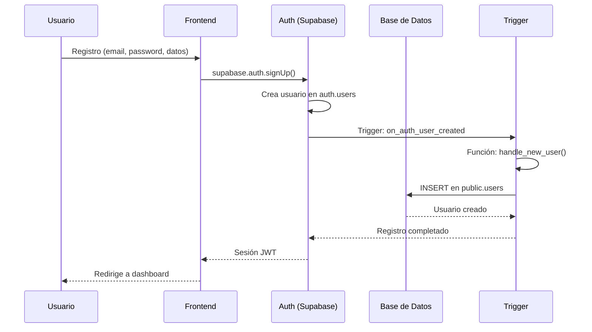
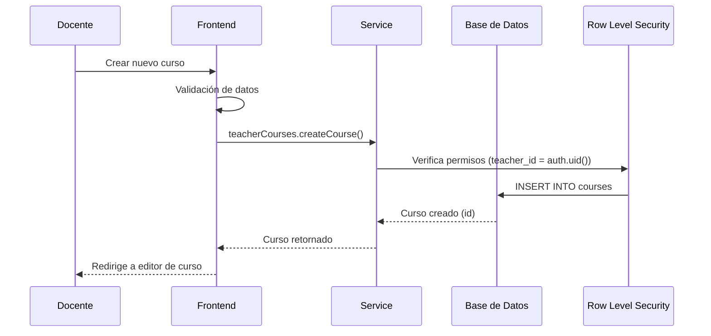
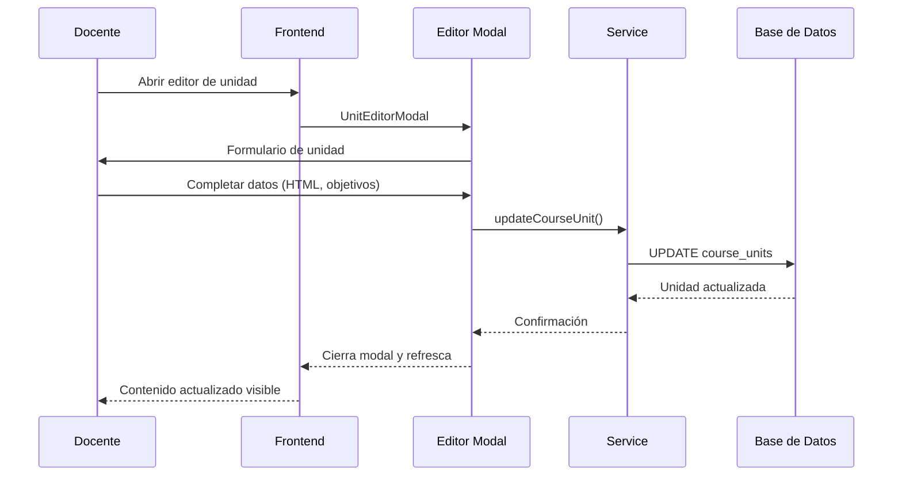
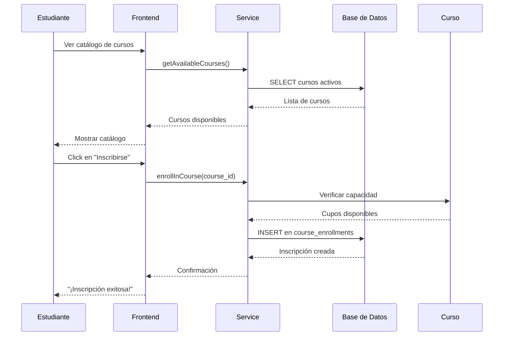
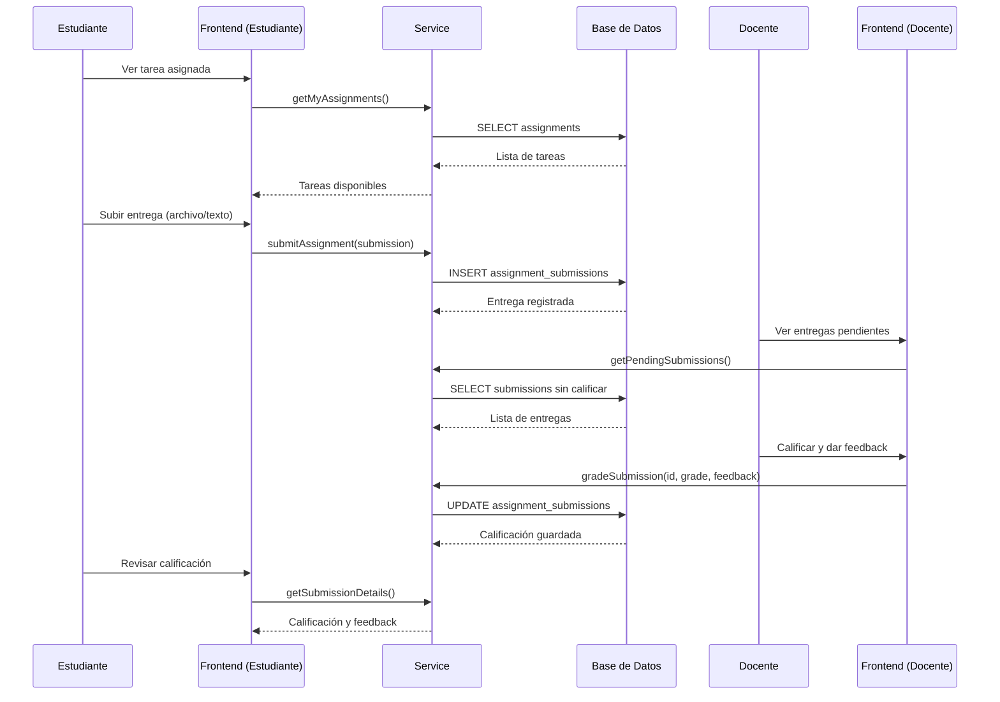
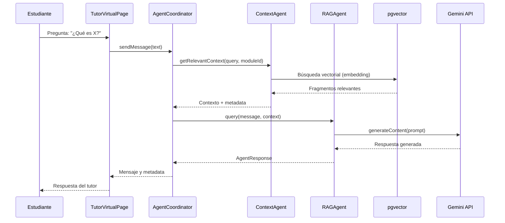
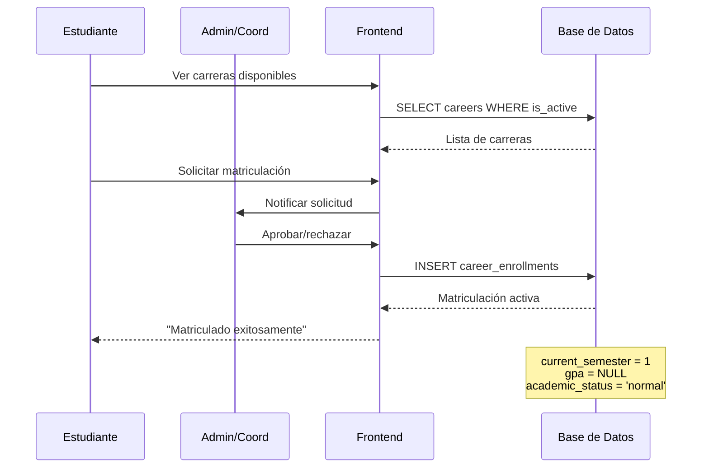

# 📚 EduSpark - Documentación de Lógica de Negocio y Flujos del Sistema

**Fecha:** Noviembre 2025  
**Versión:** 3.2 - Fase 1 Implementada  
**Estado:** ✅ Sistema Funcional

---

## 📋 Índice

1. [Visión General del Sistema](#1-visión-general-del-sistema)
2. [Modelo Entidad-Relación](#2-modelo-entidad-relación)
3. [Flujos de Negocio Principales](#3-flujos-de-negocio-principales)
4. [Roles y Permisos](#4-roles-y-permisos)
5. [Arquitectura del Sistema](#5-arquitectura-del-sistema)
6. [Lógica de Negocio Detallada](#6-lógica-de-negocio-detallada)

---

## 1. Visión General del Sistema

### 🎯 Propósito
EduSpark es una plataforma educativa inteligente que integra:
- **Gestión académica** completa (carreras, materias, cursos)
- **Gestión de contenido** didáctico rico (unidades, sesiones, materiales)
- **Sistema de evaluación** (tareas, quizz, calificaciones)
- **Tutor virtual con IA** usando RAG (Retrieval-Augmented Generation)
- **Analítica predictiva** para seguimiento del estudiante

### 🏗️ Stack Tecnológico
- **Frontend:** React + TypeScript + Tailwind CSS
- **Backend:** Supabase (PostgreSQL + Auth + Storage + Real-time)
- **IA:** Google Gemini API + RAG con embeddings
- **Seguridad:** Row Level Security (RLS) + JWT

---

## 2. Modelo Entidad-Relación

### 📊 Diagrama Conceptual

```
┌──────────┐         ┌──────────┐         ┌──────────┐
│  ROLES   │◄───────┐│  USERS   │         │CARRIERS  │
│          │        ││          │         │          │
│ id (PK)  │        ││ id (PK)  │         │ id (PK)  │
│ name     │        ││ email    │         │ name     │
│ desc     │        ││ fname    │         │ code     │
└──────────┘        ││ lname    │         │ coord_id │
                    ││ role_id  ├────────┤└────┬─────┘
                    └────┬──────┘        │    │
                         │                └────┤
                    ┌────▼─────┐         ┌────▼─────┐
                    │TEACHERS  │         │SUBJECTS  │
                    │          │         │          │
                    │(via role)│         │ id (PK)  │
                    └────┬─────┘         │ career_id│
                         │                │ name     │
                         │                │ code     │
                         │                │ semester │
                         │                └────┬─────┘
                    ┌────▼─────────┐           │
                    │   COURSES    │◄──────────┘
                    │              │
                    │ id (PK)      │
                    │ title        │
                    │ teacher_id   │
                    │ subject_id   │
                    │ status       │
                    └──────┬───────┘
                           │
           ┌───────────────┼───────────────┐
           │               │               │
    ┌──────▼──────┐ ┌──────▼──────┐ ┌──────▼────────┐
    │ COURSE_UNITS│ │  SESSIONS   │ │ENROLLMENTS    │
    │             │ │             │ │               │
    │ id (PK)     │ │ id (PK)     │ │ id (PK)       │
    │ course_id   │ │ course_id   │ │ student_id    │
    │ title       │ │ unit_id     │ │ course_id     │
    │ content_html│ │ content_html│ │ status        │
    │ objectives[]│ │ activities  │ │ final_grade   │
    └──────┬──────┘ └──────┬──────┘ └───────────────┘
           │               │
    ┌──────▼──────────┐ ┌──▼────────────┐
    │    MATERIALS    │ │ ASSIGNMENTS   │
    │                 │ │               │
    │ id (PK)         │ │ id (PK)       │
    │ course_id       │ │ course_id     │
    │ unit_id         │ │ title         │
    │ session_id      │ │ due_date      │
    │ title           │ │ max_points    │
    │ url             │ └──────┬────────┘
    └─────────────────┘        │
                        ┌──────▼──────────┐
                        │SUBMISSIONS      │
                        │                 │
                        │ id (PK)         │
                        │ assignment_id   │
                        │ student_id      │
                        │ grade           │
                        │ feedback        │
                        └─────────────────┘
```

### 🗄️ Tablas Principales

#### A. Gestión de Usuarios y Roles

##### 1. `roles`
```sql
CREATE TABLE roles (
    id SERIAL PRIMARY KEY,
    name VARCHAR(50) UNIQUE NOT NULL,      -- admin, teacher, student, coordinator
    description TEXT,
    created_at TIMESTAMP DEFAULT NOW(),
    updated_at TIMESTAMP DEFAULT NOW()
);
```
**Roles del Sistema:**
- `1` - `admin` - Administrador total del sistema
- `2` - `teacher` - Docente/facilitador
- `3` - `student` - Estudiante
- `4` - `coordinator` - Coordinador académico

##### 2. `users`
```sql
CREATE TABLE users (
    id UUID PRIMARY KEY,                   -- Sincronizado con auth.users
    email VARCHAR(255) UNIQUE NOT NULL,
    first_name VARCHAR(100) NOT NULL,
    last_name VARCHAR(100) NOT NULL,
    role_id INTEGER REFERENCES roles(id),
    is_active BOOLEAN DEFAULT true,
    email_verified BOOLEAN DEFAULT false,
    last_login TIMESTAMP,
    created_at TIMESTAMP DEFAULT NOW(),
    updated_at TIMESTAMP DEFAULT NOW()
);
```
**Sincronización Automática:**
- Trigger `on_auth_user_created` sincroniza con `auth.users`
- Función `handle_new_user()` crea registro en `public.users`
- RPC `create_user_profile()` como fallback

#### B. Estructura Académica

##### 3. `careers` (Carreras/Mallas Curriculares)
```sql
CREATE TABLE careers (
    id SERIAL PRIMARY KEY,
    name VARCHAR(255) NOT NULL,
    code VARCHAR(50) UNIQUE NOT NULL,
    description TEXT,
    coordinator_id UUID REFERENCES users(id),
    duration_months INTEGER DEFAULT 48,
    total_credits INTEGER DEFAULT 0,
    degree_type VARCHAR(50) DEFAULT 'bachelor',
    is_active BOOLEAN DEFAULT true,
    created_at TIMESTAMPTZ DEFAULT NOW(),
    updated_at TIMESTAMPTZ DEFAULT NOW()
);
```

##### 4. `subjects` (Materias/Disciplinas)
```sql
CREATE TABLE subjects (
    id SERIAL PRIMARY KEY,
    career_id INTEGER REFERENCES careers(id) ON DELETE CASCADE,
    name VARCHAR(255) NOT NULL,
    code VARCHAR(50) NOT NULL,
    description TEXT,
    credits INTEGER DEFAULT 0,
    hours_per_week INTEGER DEFAULT 0,
    semester INTEGER,
    prerequisite_subject_id INTEGER REFERENCES subjects(id),
    is_core BOOLEAN DEFAULT true,
    difficulty_level VARCHAR(20) DEFAULT 'intermediate',
    created_at TIMESTAMPTZ DEFAULT NOW(),
    updated_at TIMESTAMPTZ DEFAULT NOW(),
    UNIQUE(career_id, code)
);
```

##### 5. `courses` (Cursos Instancias)
```sql
CREATE TABLE courses (
    id SERIAL PRIMARY KEY,
    title TEXT NOT NULL,
    code TEXT UNIQUE,
    description TEXT,
    teacher_id UUID NOT NULL REFERENCES users(id) ON DELETE CASCADE,
    status TEXT NOT NULL DEFAULT 'active',
    -- Relación académica
    subject_id INTEGER REFERENCES subjects(id) ON DELETE SET NULL,
    academic_period VARCHAR(50),
    start_date DATE,
    end_date DATE,
    schedule JSONB DEFAULT '[]'::jsonb,
    max_students INTEGER,
    created_at TIMESTAMPTZ DEFAULT NOW(),
    updated_at TIMESTAMPTZ DEFAULT NOW()
);
```

#### C. Contenido Didáctico

##### 6. `course_units` (Unidades/Lecciones)
```sql
CREATE TABLE course_units (
    id UUID PRIMARY KEY DEFAULT gen_random_uuid(),
    course_id INTEGER NOT NULL REFERENCES courses(id) ON DELETE CASCADE,
    number INT NOT NULL,
    title TEXT NOT NULL,
    description TEXT,
    -- Contenido rico
    content_html TEXT,                    -- HTML enriquecido
    content_markdown TEXT,                -- Markdown alternativo
    learning_objectives TEXT[],           -- Array de objetivos
    duration_hours DECIMAL(5,2),
    order_index INTEGER,
    thumbnail_url TEXT,
    created_at TIMESTAMPTZ NOT NULL DEFAULT NOW(),
    updated_at TIMESTAMPTZ DEFAULT NOW()
);
```

##### 7. `sessions` (Sesiones/Clases Individuales)
```sql
CREATE TABLE sessions (
    id UUID PRIMARY KEY DEFAULT gen_random_uuid(),
    course_id INTEGER NOT NULL REFERENCES courses(id) ON DELETE CASCADE,
    unit_id UUID REFERENCES course_units(id) ON DELETE SET NULL,
    title TEXT NOT NULL,
    starts_at TIMESTAMPTZ,
    ends_at TIMESTAMPTZ,
    description TEXT,
    -- Contenido rico
    content_html TEXT,
    content_markdown TEXT,
    learning_objectives TEXT[],
    activities JSONB DEFAULT '[]'::jsonb,  -- Ejercicios, prácticas
    resources JSONB DEFAULT '[]'::jsonb,   -- Videos, imágenes, enlaces
    duration_minutes INTEGER,
    order_index INTEGER,
    session_type VARCHAR(50) DEFAULT 'lecture',
    created_at TIMESTAMPTZ NOT NULL DEFAULT NOW()
);
```

##### 8. `materials` (Materiales de Curso)
```sql
CREATE TABLE materials (
    id UUID PRIMARY KEY DEFAULT gen_random_uuid(),
    course_id INTEGER NOT NULL REFERENCES courses(id) ON DELETE CASCADE,
    unit_id UUID REFERENCES course_units(id) ON DELETE SET NULL,
    session_id UUID REFERENCES sessions(id) ON DELETE SET NULL,
    title TEXT NOT NULL,
    kind TEXT NOT NULL,                   -- markdown, pdf, link, video, other
    url TEXT,
    mime_type TEXT,
    size_bytes BIGINT,
    metadata JSONB DEFAULT '{}'::jsonb,
    created_at TIMESTAMPTZ NOT NULL DEFAULT NOW()
);
```

#### D. Evaluación y Entregas

##### 9. `assignments` (Tareas)
```sql
CREATE TABLE assignments (
    id UUID PRIMARY KEY DEFAULT gen_random_uuid(),
    course_id INTEGER NOT NULL REFERENCES courses(id) ON DELETE CASCADE,
    unit_id UUID REFERENCES course_units(id) ON DELETE SET NULL,
    session_id UUID REFERENCES sessions(id) ON DELETE SET NULL,
    title TEXT NOT NULL,
    description TEXT,
    due_at TIMESTAMPTZ NOT NULL,
    max_points DECIMAL(5,2) DEFAULT 100,
    attachments JSONB DEFAULT '[]'::jsonb,
    created_at TIMESTAMPTZ NOT NULL DEFAULT NOW(),
    updated_at TIMESTAMPTZ DEFAULT NOW()
);
```

##### 10. `assignment_submissions` (Entregas)
```sql
CREATE TABLE assignment_submissions (
    id UUID PRIMARY KEY DEFAULT gen_random_uuid(),
    assignment_id UUID NOT NULL REFERENCES assignments(id) ON DELETE CASCADE,
    student_id UUID NOT NULL REFERENCES users(id) ON DELETE CASCADE,
    submitted_at TIMESTAMPTZ DEFAULT NOW(),
    url TEXT,                             -- URL de archivo subido
    text TEXT,                            -- Texto de entrega
    grade DECIMAL(5,2),                   -- Calificación
    feedback TEXT,                        -- Feedback del docente
    created_at TIMESTAMPTZ NOT NULL DEFAULT NOW(),
    updated_at TIMESTAMPTZ DEFAULT NOW(),
    UNIQUE(assignment_id, student_id)
);
```

#### E. Matriculación

##### 11. `career_enrollments` (Matriculación a Carreras)
```sql
CREATE TABLE career_enrollments (
    id UUID PRIMARY KEY DEFAULT gen_random_uuid(),
    student_id UUID NOT NULL REFERENCES users(id) ON DELETE CASCADE,
    career_id INTEGER NOT NULL REFERENCES careers(id) ON DELETE CASCADE,
    enrollment_date DATE DEFAULT CURRENT_DATE,
    status VARCHAR(20) DEFAULT 'active',
    graduation_date DATE,
    current_semester INTEGER DEFAULT 1,
    total_credits_earned INTEGER DEFAULT 0,
    gpa DECIMAL(4,2),
    academic_status VARCHAR(50) DEFAULT 'normal',
    created_at TIMESTAMPTZ DEFAULT NOW(),
    updated_at TIMESTAMPTZ DEFAULT NOW(),
    UNIQUE(student_id, career_id)
);
```

##### 12. `course_enrollments` (Inscripción a Cursos)
```sql
CREATE TABLE course_enrollments (
    id UUID PRIMARY KEY DEFAULT gen_random_uuid(),
    student_id UUID NOT NULL REFERENCES users(id) ON DELETE CASCADE,
    course_id INTEGER NOT NULL REFERENCES courses(id) ON DELETE CASCADE,
    enrollment_date DATE DEFAULT CURRENT_DATE,
    status VARCHAR(20) DEFAULT 'active',
    final_grade DECIMAL(5,2),
    letter_grade VARCHAR(5),
    attendance_percentage DECIMAL(5,2) DEFAULT 0,
    participation_score DECIMAL(5,2) DEFAULT 0,
    completion_percentage DECIMAL(5,2) DEFAULT 0,
    time_spent_minutes INTEGER DEFAULT 0,
    last_access_at TIMESTAMPTZ,
    completed_at TIMESTAMPTZ,
    created_at TIMESTAMPTZ DEFAULT NOW(),
    updated_at TIMESTAMPTZ DEFAULT NOW(),
    UNIQUE(student_id, course_id)
);
```

#### F. Sistema de IA (RAG - Tutor Virtual)

##### 13. `course_content_chunks` (Fragmentos para RAG)
```sql
CREATE TABLE course_content_chunks (
    id UUID PRIMARY KEY DEFAULT gen_random_uuid(),
    course_id INTEGER REFERENCES courses(id) ON DELETE CASCADE,
    content TEXT NOT NULL,
    embedding VECTOR(768),                -- pgvector
    metadata JSONB DEFAULT '{}'::jsonb,
    source_url TEXT,
    created_at TIMESTAMPTZ DEFAULT NOW()
);
```

**Índice vectorial:**
```sql
CREATE INDEX ON course_content_chunks 
USING ivfflat (embedding vector_cosine_ops);
```

---

## 3. Flujos de Negocio Principales

### 🔐 F1: Flujo de Autenticación y Registro



**Datos Sincronizados:**
- `id` - UUID del usuario (de auth.users)
- `email` - Email del usuario
- `first_name` - Nombre (de metadata)
- `last_name` - Apellido (de metadata)
- `role_id` - Rol asignado (default: 3 = student)

**Fallback RPC:**
Si el trigger falla, se puede usar:
```sql
SELECT * FROM create_user_profile(
  p_user_id, 
  p_email, 
  p_first_name, 
  p_last_name, 
  p_role_id
);
```

### 🎓 F2: Flujo de Creación de Curso por Docente



**Validaciones:**
- Usuario autenticado como docente
- `teacher_id` coincide con `auth.uid()`
- Campos requeridos validados
- Código único si se proporciona

**Datos Opcionales:**
- `subject_id` - Si viene desde una materia
- `academic_period` - Período académico
- `start_date`, `end_date` - Fechas del curso
- `max_students` - Límite de inscripciones

### 📚 F3: Flujo de Gestión de Contenido (Unidades y Sesiones)



**Contenido Rico:**
- HTML enriquecido con imágenes embebidas (base64 o URLs)
- Markdown como alternativa
- Array de `learning_objectives`
- Duración estimada
- Orden de visualización

**Optimización de Imágenes:**
- Compresión automática en frontend
- Conversión a WebP cuando es posible
- Almacenamiento en Supabase Storage
- Fallback a base64 en HTML

### 🎯 F4: Flujo de Inscripción de Estudiante



**Validaciones:**
- Estudiante autenticado
- Curso activo y disponible
- No duplicar inscripciones
- Verificar límite de estudiantes
- Verificar prerrequisitos (si aplica)

### 📝 F5: Flujo de Entrega y Calificación



### 🤖 F6: Flujo del Tutor Virtual (RAG)



**Anclaje por Módulo:**
- Tutor se ancla a `courseId` y `moduleId`
- RAG filtra/prioriza contenido del módulo
- Fallback a contenido del curso completo

**Componentes del Sistema A2A:**
1. **AgentCoordinator**: Orquesta agentes locales
2. **ContextAgent**: Búsqueda RAG en pgvector
3. **RAGAgent**: Generación con Gemini
4. **VoiceAgent**: (opcional) Manejo de audio

### 📊 F7: Flujo de Matriculación a Carrera



---

## 4. Roles y Permisos

### 🔐 Matriz de Permisos (RLS)

| Entidad | Admin | Coordinator | Teacher | Student |
|---------|-------|-------------|---------|---------|
| **users** | CRUD todos | Read | Read propio | Read propio |
| **roles** | CRUD | Read | Read | Read |
| **careers** | CRUD | CRUD propias | Read | Read activas |
| **subjects** | CRUD | CRUD propias | Read | Read |
| **courses** | CRUD todos | Read | CRUD propias | Read inscritos |
| **course_units** | CRUD | Read | CRUD curso | Read curso |
| **sessions** | CRUD | Read | CRUD curso | Read curso |
| **materials** | CRUD | Read | CRUD curso | Read curso |
| **assignments** | CRUD | Read | CRUD curso | Read y Submit |
| **submissions** | CRUD | Read | Read y Grade | CRUD propio |
| **enrollments** | CRUD todos | Read propias | Read curso | Read propio |

### 🛡️ Políticas RLS Clave

#### Para `courses`:
```sql
-- Docentes pueden CRUD sus propios cursos
CREATE POLICY "Teachers CRUD own courses"
ON courses FOR ALL
USING (teacher_id = auth.uid());

-- Estudiantes pueden leer cursos en los que están inscritos
CREATE POLICY "Students read enrolled courses"
ON courses FOR SELECT
USING (
  EXISTS (
    SELECT 1 FROM course_enrollments 
    WHERE student_id = auth.uid() 
    AND course_id = courses.id
  )
);
```

#### Para `course_enrollments`:
```sql
-- Estudiantes pueden ver sus propias inscripciones
CREATE POLICY "Students view own enrollments"
ON course_enrollments FOR SELECT
USING (student_id = auth.uid());

-- Docentes pueden ver inscripciones de sus cursos
CREATE POLICY "Teachers view course enrollments"
ON course_enrollments FOR SELECT
USING (
  EXISTS (
    SELECT 1 FROM courses 
    WHERE teacher_id = auth.uid() 
    AND courses.id = course_id
  )
);
```

#### Para `assignments`:
```sql
-- Docentes pueden CRUD tareas de sus cursos
CREATE POLICY "Teachers CRUD assignments"
ON assignments FOR ALL
USING (
  EXISTS (
    SELECT 1 FROM courses 
    WHERE teacher_id = auth.uid() 
    AND courses.id = course_id
  )
);
```

#### Para `assignment_submissions`:
```sql
-- Estudiantes pueden crear y actualizar sus entregas
CREATE POLICY "Students CRUD own submissions"
ON assignment_submissions FOR ALL
USING (student_id = auth.uid());

-- Docentes pueden ver y calificar entregas de sus cursos
CREATE POLICY "Teachers grade submissions"
ON assignment_submissions FOR SELECT, UPDATE
USING (
  EXISTS (
    SELECT 1 FROM assignments a
    JOIN courses c ON c.id = a.course_id
    WHERE c.teacher_id = auth.uid() 
    AND a.id = assignment_id
  )
);
```

---

## 5. Arquitectura del Sistema

### 🏛️ Arquitectura General

```
┌─────────────────────────────────────────────────────────────┐
│                     FRONTEND (React)                         │
│  ┌────────────┐  ┌─────────────┐  ┌───────────────────┐   │
│  │LandingPage │  │ LoginPage   │  │ TutorVirtualPage  │   │
│  └────────────┘  └─────────────┘  └──────────┬────────┘   │
│  ┌────────────┐  ┌─────────────┐             │            │
│  │Dashboard   │  │CoursesPage  │  ┌──────────▼──────────┐ │
│  └────────────┘  └─────────────┘  │ AgentCoordinator    │ │
│                                   │  (A2A Local)         │ │
└───────────────────────────────────┴──────────┬───────────┘ │
                                               │              │
┌──────────────────────────────────────────────┴───────────┐ │
│                    SERVICIOS                              │ │
│  ┌────────────────┐  ┌─────────────┐  ┌──────────────┐   │ │
│  │useAuth         │  │teacherCourse│  │ragService    │   │ │
│  │useAgentSystem  │  │assignmentSer│  │academicService│  │ │
│  └────────────────┘  └─────────────┘  └──────┬───────┘   │ │
└────────────────────────────────────────────────┼──────────┘ │
                                                 │            │
┌────────────────────────────────────────────────┼──────────┐ │
│             SUPABASE BACKEND                    │         │ │
│  ┌─────────────────────────────────────────────┘         │ │
│  │  ┌──────────────┐  ┌────────────┐  ┌────────────┐   │ │
│  │  │   Auth       │  │ PostgreSQL │  │  Storage   │   │ │
│  │  │  (JWT)       │  │  + RLS     │  │ (Imágenes) │   │ │
│  │  └──────────────┘  └──────┬─────┘  └────────────┘   │ │
│  │                           │                          │ │
│  │  ┌────────────────────────▼────────────┐            │ │
│  │  │       pgvector (RAG)                │            │ │
│  │  │  course_content_chunks              │            │ │
│  │  └─────────────────────────────────────┘            │ │
│  └──────────────────────────────────────────────────────┘ │
└────────────────────────────────────────────────────────────┘
                                                 │
┌────────────────────────────────────────────────┴──────────┐
│              GOOGLE GEMINI API                             │
│  ┌──────────────┐              ┌──────────────────────┐   │
│  │ embedContent │              │ generateContent      │   │
│  │ (Vectores)   │              │ (Respuestas)         │   │
│  └──────────────┘              └──────────────────────┘   │
└────────────────────────────────────────────────────────────┘
```

### 🔄 Flujo de Datos (Tutor Virtual RAG)

```
1. Usuario pregunta en chat
   ↓
2. Frontend → AgentCoordinator.sendMessage()
   ↓
3. ContextAgent → Embedding de la pregunta
   ↓
4. Búsqueda vectorial en pgvector
   → SELECT * FROM course_content_chunks
   → ORDER BY embedding <=> query_embedding
   → LIMIT 5
   ↓
5. RAGAgent → Construye prompt con contexto
   ↓
6. Gemini API → generateContent(prompt)
   ↓
7. Respuesta generada → Frontend
   ↓
8. UI actualiza mensajes
```

---

## 6. Lógica de Negocio Detallada

### 🎓 Lógica de Cursos

#### Creación de Curso
1. **Validación inicial:**
   - Usuario autenticado
   - Rol = `teacher`
   - Título no vacío
   - Código único (si se proporciona)

2. **Asignación automática:**
   - `teacher_id` = `auth.uid()`
   - `status` = `'draft'` o `'active'`
   - `created_at` = NOW()
   - `updated_at` = NOW()

3. **Campos opcionales:**
   - `subject_id` - Si viene desde navegación de materias
   - `academic_period` - Período académico
   - `max_students` - Capacidad máxima

#### Gestión de Contenido Rico
1. **HTML vs Markdown:**
   - Editor principal genera HTML
   - Markdown como alternativa
   - Conversión bidireccional opcional

2. **Objetivos de Aprendizaje:**
   - Array TEXT[] en PostgreSQL
   - Función RPC para actualizar: `update_unit_learning_objectives()`
   - Evita problemas de serialización del cliente JS

3. **Optimización de Imágenes:**
   - Compresión en frontend antes de subir
   - Conversión a WebP cuando es posible
   - Almacenamiento en Supabase Storage
   - Fallback a base64 embebido en HTML

### 📝 Lógica de Evaluación

#### Creación de Tarea
1. **Datos requeridos:**
   - `title` - Título de la tarea
   - `description` - Descripción completa
   - `due_at` - Fecha límite
   - `max_points` - Puntaje máximo

2. **Validaciones:**
   - Docente es propietario del curso
   - Fecha límite futura
   - Puntaje > 0

#### Entrega de Estudiante
1. **Subida de archivo:**
   - Subir a Supabase Storage
   - Obtener URL pública
   - Guardar URL en `assignment_submissions.url`

2. **Entrega de texto:**
   - Guardar directamente en `assignment_submissions.text`

3. **Validaciones:**
   - Estudiante inscrito en el curso
   - Fecha límite no expirada (o permitir tardíos)
   - No duplicar entrega (ON CONFLICT)

#### Calificación de Docente
1. **Proceso:**
   - Docente revisa entrega
   - Asigna calificación (0 - max_points)
   - Escribe feedback
   - Guarda en `assignment_submissions`

2. **Actualización automática:**
   - Recalcular `completion_percentage` del estudiante
   - Actualizar `course_enrollments.final_grade`

### 🤖 Lógica del Tutor Virtual

#### Búsqueda RAG
1. **Embedding de consulta:**
   ```typescript
   const embedding = await generateEmbedding(query);
   ```

2. **Búsqueda vectorial:**
   ```sql
   SELECT * FROM course_content_chunks
   WHERE course_id = :courseId
   ORDER BY embedding <=> :queryEmbedding::vector
   LIMIT 5;
   ```

3. **Construcción de prompt:**
   ```typescript
   const prompt = `
     Contexto del curso:
     ${contextChunks.join('\n\n')}
     
     Pregunta del estudiante:
     ${query}
     
     Responde de manera clara y empática:
   `;
   ```

4. **Generación de respuesta:**
   - Llamada a Gemini con el prompt
   - Streaming de respuesta (opcional)
   - Guardar en historial

#### Historial de Conversación
1. **Almacenamiento:**
   - Tabla `tutor_conversations` (opcional)
   - Guarda mensajes del estudiante y respuestas
   - Metadata: timestamp, course_id, module_id

2. **Contexto persistente:**
   - Mantener últimas N mensajes en memoria
   - Referenciar conversaciones previas
   - Personalización basada en historial

### 📊 Lógica de Matriculación

#### Inscripción a Carrera
1. **Proceso:**
   - Estudiante solicita matriculación
   - Admin/Coord aprueba o rechaza
   - Se crea registro en `career_enrollments`
   - `current_semester` = 1
   - `academic_status` = 'normal'

2. **Actualización automática:**
   - Calcular GPA cuando hay calificaciones
   - Actualizar `total_credits_earned`
   - Verificar requisitos de graduación

#### Inscripción a Curso
1. **Validaciones:**
   - Estudiante matriculado en carrera
   - Cupos disponibles
   - Prerrequisitos cumplidos (si aplica)
   - No duplicar inscripción

2. **Actualización automática:**
   - Incrementar `courses.current_students`
   - Crear registro en `course_enrollments`
   - Estado inicial: `active`

---

## 🔍 Reglas de Negocio Importantes

### 1. Sincronización de Usuarios
- **Trigger automático:** `on_auth_user_created` → `handle_new_user()`
- **Fallback RPC:** `create_user_profile()` si el trigger falla
- **Integridad:** `public.users.id` siempre coincide con `auth.users.id`

### 2. Propiedad de Contenido
- Los cursos pertenecen al docente creador (`teacher_id`)
- Solo el propietario o admin puede modificar contenido
- RLS garantiza el aislamiento de datos

### 3. Rol por Defecto
- Nuevos usuarios: `role_id = 3` (student)
- Solo admin puede cambiar roles
- Coordinador y docente: asignación manual por admin

### 4. Contenido Didáctico Rico
- HTML embebido permite imágenes y videos
- Almacenamiento optimizado (compresión, WebP)
- Markdown como alternativa ligera

### 5. Seguridad y Privacidad
- RLS habilitado en todas las tablas
- Políticas granulares por rol
- Auditoría con `created_at`, `updated_at`
- Soft deletes cuando es posible

---

## 📚 Referencias

### Documentación Adicional
- `AI_CONTEXT/schema_actual.md` - Esquema completo de BD
- `AI_CONTEXT/modelo_datos_detallado.md` - Especificación técnica
- `AI_CONTEXT/flujos_criticos.md` - Flujos arquitectónicos
- `AI_CONTEXT/README.md` - Guía del asistente IA
- `ESTADO_PROYECTO_COMPLETO.md` - Estado del proyecto

### Scripts SQL
- `sql_scripts/01_schema_courses.sql` - Tablas de cursos
- `sql_scripts/02_schema_assignments.sql` - Tablas de tareas
- `sql_scripts/41_create_update_learning_objectives_rpc.sql` - RPC
- `sql_scripts/45_fix_user_registration_trigger.sql` - Trigger usuarios

---

**Fin del documento**

