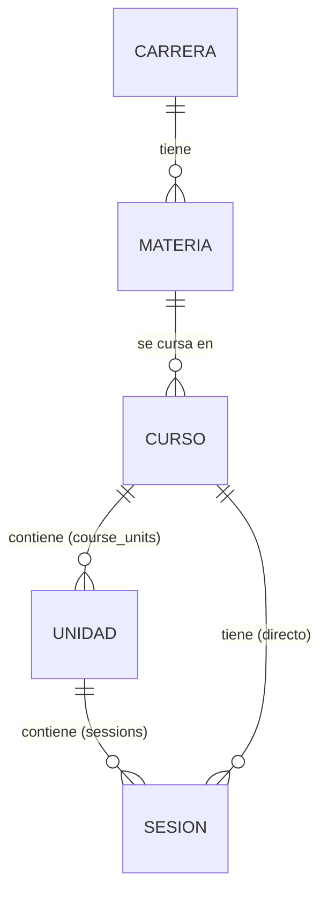

# Diagrama ER – Esquema de EduSpark

**Leyenda**
- `||--o{` = relación uno‑a‑muchos.
- `UNIDAD` corresponde a la tabla `course_units`.
- `SESION` corresponde a la tabla `sessions`.
- Las claves foráneas se añaden en `add_foreign_keys.sql`.
